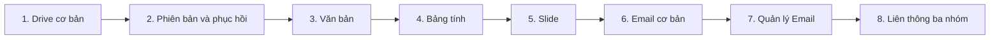

# Biên bản: thứ tự phát triển tính năng VCworkspace

- Ngày: 2026-10-23.
- Yêu cầu chủ dự án: ghi biên bản và phát triển lần lượt từng tính năng của ba nhóm Email, Office (văn bản/bảng tính/slide) và Drive.
- Thứ tự thực hiện do AI lựa chọn: **Drive → Văn bản → Bảng tính → Slide → Email → Liên thông Email–Drive–Office**.
- Trạng thái: đã ghi kế hoạch; chưa bắt đầu viết mã hoặc triển khai dịch vụ qua phiên này. Chưa chốt mua dịch vụ, dữ liệu thật, hạ tầng hoặc thay Google.

## 1. Tính năng đầu tiên: Drive — lưu và lấy đúng tệp theo quyền

**Kết quả cần nhìn thấy:** người dùng đăng nhập bằng tài khoản thử, tạo thư mục, tải một tệp lên, thấy tệp trong danh sách và tải lại đúng nội dung. Người không có quyền không đọc hoặc sửa được tệp, kể cả gọi trực tiếp API.

Phạm vi đợt đầu:

1. Môi trường dữ liệu thử và hai người dùng có quyền khác nhau; dùng danh tính thử có sẵn, chưa di cư tài khoản công ty.
2. Không gian cá nhân/phòng ban thử và cây thư mục; tạo thư mục, xem danh sách.
3. Tải tệp lên, tải xuống; kiểm tên, dung lượng và loại tệp theo cấu hình đã thống nhất.
4. Ghi mã tệp ổn định, mã thư mục, chủ thể/phạm vi sở hữu và người thao tác; không dùng đường dẫn hoặc tên tệp làm định danh duy nhất.
5. Quyền xem/sửa được kiểm ở lớp nghiệp vụ và kho lưu trữ; không chỉ ẩn nút giao diện.
6. Nhật ký tạo thư mục, tải lên và kết quả bị từ chối; không ghi nội dung tệp hoặc bí mật vào nhật ký.

Điều kiện hoàn thành:

- Tệp tải lại có mã băm khớp tệp ban đầu; danh sách, thư mục và mã tệp nhất quán.
- Khởi động lại môi trường thử vẫn thấy và đọc được dữ liệu đã lưu.
- Người được cấp quyền đọc đúng; người không được cấp quyền bị từ chối khi gọi trực tiếp.
- Tải lên thất bại không hiện thành tệp đã lưu thành công; xử lý rõ khi gửi lại yêu cầu và khi trùng tên.
- Có bằng chứng luồng giao diện/API và kiểm tra quyền trên kho thử. Bản giả chỉ chứng minh logic; không thay PoC trên Nextcloud thử riêng.

**Lý do làm trước:** Office cần một nơi lưu có quyền và định danh đúng; Email cần nơi chọn/lưu tài liệu đính kèm. Chứng minh đường lưu–đọc này trước sẽ tránh phát triển giao diện soạn thảo rồi mới phát hiện tài liệu lưu sai hoặc lộ quyền.

## 2. Các đợt tiếp theo — làm tuần tự, mỗi đợt có điểm nghiệm thu

| Đợt | Tính năng | Phạm vi chính | Điều kiện qua đợt |
|---|---|---|---|
| 1 | Drive cơ bản | Thư mục, upload/download, mã tệp, quyền và nhật ký | Đạt toàn bộ mục 1 |
| 2 | Drive an toàn dữ liệu | Đổi tên/di chuyển, phiên bản, thùng rác/khôi phục; thử sao lưu và phục hồi | Giữ định danh khi di chuyển; khôi phục đúng bản và quyền; không làm mất tệp khi thao tác lỗi |
| 3 | Soạn thảo văn bản | Tạo tài liệu từ mẫu, mở/sửa bằng ONLYOFFICE qua connector, lưu về Drive, xuất DOCX/PDF | Mở lại thấy đúng nội dung; xác nhận kho đã lưu trước báo thành công; kiểm người xem/người sửa, lưu đồng thời và lỗi lưu |
| 4 | Bảng tính | Tạo/mở XLSX, nhập dữ liệu, công thức/lọc/sắp xếp cơ bản, lưu và xuất | Bộ bảng tính/công thức đại diện cho nghiệp vụ đạt; không mặc định Apps Script/macro Google tương thích |
| 5 | Slide | Tạo từ mẫu, sửa nội dung/bố cục, mở trình chiếu, lưu và xuất PPTX/PDF | Mở lại giữ nội dung/bố cục chấp nhận được; kiểm mẫu và font thực tế |
| 6 | Email cơ bản | Hộp thư thử, nhận/gửi, trả lời/chuyển tiếp, bản nháp, hội thoại và attachment | Thử trong hệ mail cô lập trước; gửi ra ngoài chỉ khi có phạm vi vận hành được giao; kiểm nhận, gửi, thư lỗi và trạng thái |
| 7 | Quản lý Email | Nhãn, tìm kiếm, bộ lọc, alias; phân quyền hộp thư nhóm theo yêu cầu đã chốt | Giữ đúng nhãn/tìm kiếm; không nhầm alias với hộp thư dùng chung có người xử lý; thử thu hồi người dùng và client điện thoại cần hỗ trợ |
| 8 | Liên thông ba nhóm | Lưu attachment vào Drive, chọn tệp Drive để gửi, mở/sửa qua Office rồi gửi lại | Đúng thư mục/quyền/phiên bản; phân biệt gửi bản đính kèm với gửi link; chỉ báo thành công khi từng bước thực sự hoàn tất |

Trước đợt 3–5 phải chọn bản engine/connector còn được hỗ trợ, đọc giấy phép và thử tương thích; bảng trên không xác nhận tính năng đã chạy trên hạ tầng hiện tại. Authentik/Nextcloud/ONLYOFFICE/Stalwart là hướng tích hợp đã đề xuất, chưa phải các dịch vụ đã cài.

## 3. Quy tắc thực hiện

- Mỗi đợt có phạm vi và bằng chứng nghiệm thu riêng; không báo hoàn thành chỉ vì build/test xanh hoặc bản giả chạy được.
- Chuẩn bị đăng nhập và quyền tối thiểu ngay ở đợt Drive, không để phân quyền tới cuối dự án.
- Dùng connector và lõi phần mềm có sẵn; phát triển phần nghiệp vụ còn thiếu. Chưa chia thành nhiều microservice hoặc viết lại toàn bộ mail/editor.
- Tài liệu làm việc ở Drive; mailbox và attachment nguyên bản ở mail server. Office lưu lại qua connector/API; không ghi thẳng vào thư mục dữ liệu của engine. Hồ sơ chốt là nghiệp vụ kho riêng, không đồng nhất với version/thùng rác.
- Chưa chuyển dữ liệu thật, đổi MX, gửi thư thật hoặc dừng Google trong kế hoạch phát triển thử. Các thay đổi vận hành có phạm vi và quyết định riêng.
- AI đọc/soạn nháp và các công cụ mở rộng được xét sau khi luồng cốt lõi đúng; không lấy AI làm điều kiện chặn việc hoàn thành ba nhóm này.
- Nơi đặt dữ liệu, ngân sách, mức phục hồi, người vận hành và yêu cầu đặc thù vẫn theo các câu hỏi chưa chốt trong báo cáo khả thi.

## 4. Việc tiếp theo của phiên triển khai

Khảo sát phạm vi Drive hiện có và thiết kế lát cắt đợt 1 (giao diện, API, adapter lưu trữ, dữ liệu và tiêu chí quyền); ghi rõ phần tái dùng và phần cần đổi hợp đồng. Chỉ sửa `contract/openapi.yaml` khi được giao thay đổi hợp đồng. Biên bản này ghi thứ tự và điểm nghiệm thu, không xác nhận đợt 1 đã được code.

Tham chiếu: [báo cáo khả thi và Phụ lục D](../nghien-cuu/vcworkspace-nghien-cuu-kha-thi.md), [hồ sơ kiểm chứng ba mức đọc](../nghien-cuu/vcworkspace-kiem-chung-2026-10-23.md), [sổ tay dự án](../../SO_TAY_DU_AN.md).

## 5. Phân chia khung chat (chủ dự án giao ngày 2026-10-23)

Dự kiến **11 khung: khung điều phối hiện tại + 10 khung công việc mới**. Mở lần lượt, chỉ giao bước phụ thuộc sau khi có bàn giao và bằng chứng nghiệm thu bước trước. Đây là dự kiến cho phát triển và nghiệm thu môi trường thử; chuyển dữ liệu thật và vận hành production cần phạm vi riêng.

| Chat | Công việc | Sản phẩm bàn giao |
|---|---|---|
| 00 | Điều phối — chat hiện tại | Quyết định, thứ tự, theo dõi nghiệm thu |
| 01 | Khảo sát nền tảng và thiết kế Drive | Phần tái dùng, thiết kế dữ liệu/quyền/adapter, đề nghị hợp đồng, danh sách cần chủ dự án chốt |
| 02 | Drive cơ bản | Luồng tạo thư mục, tải lên/xuống, quyền, nhật ký; bằng chứng kho thử |
| 03 | Drive an toàn dữ liệu | Di chuyển, phiên bản, thùng rác, sao lưu/phục hồi |
| 04 | Văn bản | Tạo, mở, sửa, lưu, xuất DOCX/PDF |
| 05 | Bảng tính | XLSX, công thức đại diện, lọc/sắp xếp, lưu/xuất |
| 06 | Slide | Mẫu, bố cục, trình chiếu, lưu/xuất PPTX/PDF |
| 07 | Email cơ bản | Hộp thư thử, gửi/nhận, trả lời, nháp, đính kèm |
| 08 | Quản lý Email | Nhãn, tìm kiếm, bộ lọc, alias/hộp thư nhóm và quyền |
| 09 | Liên thông ba nhóm | Email → Drive → Office → Drive → Email |
| 10 | Nghiệm thu tổng thể | Kiểm quyền, lỗi, tương thích, phục hồi và hồ sơ sẵn sàng thí điểm |

Mỗi chat tính năng chịu trách nhiệm trọn luồng giao diện–API–lưu trữ–kiểm tra. Không tách riêng chat FE/BE trong dự kiến này. Nếu PoC cho thấy cần sửa hợp đồng hay hạ tầng lớn, ghi rõ và điều chỉnh số chat; không coi 11 là cam kết cố định. Chat 01 chỉ khảo sát và thiết kế, chưa sửa mã sản phẩm hoặc hợp đồng API gốc.

## 6. Gói thử Drive đã được duyệt — 2026-10-23

Chủ dự án duyệt Nextcloud cô lập trên máy local, chỉ dữ liệu giả; ACL kho theo từng người; hai tài khoản và hai không gian phòng/cá nhân; trùng tên trả 409, không ghi đè; tối đa 10 MiB/tệp trong PoC. Chat 02 chuẩn bị đề nghị hợp đồng sáu API và PoC trước code lớn; chưa được tự sửa OpenAPI gốc. Đây là duyệt gói thử, chưa duyệt production hoặc giới hạn sản phẩm chính thức.

## 7. Duyệt runtime và hợp đồng — 2026-10-23

Chủ dự án duyệt cài môi trường container local riêng và cập nhật hợp đồng sáu API Drive theo đề xuất tại `apps/api/DE_NGHI_SUA_HOP_DONG.md`. Tiếp tục chat 02: cấu hình môi trường cô lập, cập nhật OpenAPI/schema, PoC kho thật và hoàn thiện Drive cơ bản theo tiêu chí. Điều phối kiểm bằng chứng trước mở chat 03. Quyết định này thay thế giới hạn chưa sửa hợp đồng ở mục 6; không duyệt production hoặc dữ liệu thật.

## 8. Mở chat 11 và lộ trình đủ chín nhóm — 2026-10-24

Human duyệt trực tiếp “Duyệt mở chat 11” để khảo sát đủ chín nhóm chức năng,
không code lớn, cài app, mua dịch vụ hoặc thao tác production. Chat 01–10 chỉ
nghiệm thu LOCAL ba lõi Drive–Office–Email/liên thông; không được suy thành đủ
chín nhóm.

Chat 11 đã lập `vcworkspace-11-lo-trinh-9-nhom.md`: ưu tiên Nextcloud Community
+ app OSS và adapter VCworkspace; portal NestJS/Mongo chỉ tích hợp qua API,
WebDAV, event/webhook, không sửa DB Nextcloud trực tiếp. Backlog đề xuất chat
12+ đi từ Identity/Admin → Work apps → Flow → Sync/NAS → Groupware → Talk → AI
→ nghiệm thu; **không tự mở chat 12**. NAS/mobile thật, quy mô họp, production
identity, GPU/cost và topology production vẫn cần human chốt đúng thời điểm.

Review bằng chứng đã sửa: link release không dùng query platform gây hiểu nhầm;
Forms candidate NC33 là 5.3.6; ONLYOFFICE 9.4 bỏ cap connection cũ nhưng CE vẫn
khuyến nghị nhóm nhỏ, thiếu mobile web edit/cluster/support và cần legal review
AGPL/branding. Flow chỉ coi Forms→Deck là connector sẵn; event→Nest là custom
adapter chưa viết. Gói đề nghị mở chat12 là clone NC33.0.10 + Authentik/OIDC
local, bốn persona `.test`, Team Folders/audit/revoke; không chọn production IdP.
