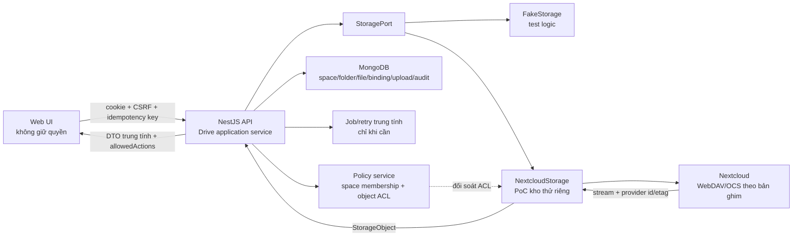

# VCworkspace 01 — khảo sát nền tảng và thiết kế Drive cơ bản

- Ngày khảo sát: 2026-10-23.
- Checkout: `/Users/apple/projects/VCdocs`, nhánh `claude/nghien-cuu-vcworkspace`.
- Phạm vi: thiết kế cho chat 02; chưa sửa mã sản phẩm, chưa sửa `contract/openapi.yaml`, chưa cài hoặc gọi Nextcloud.
- Trạng thái kiến trúc: **đề xuất để thực hiện PoC**, không phải quyết định đã duyệt dùng Nextcloud trong production.

## 1. Kết luận ngắn

Lát cắt nhỏ nhất nên làm là: hai tài khoản thử đăng nhập → người A tạo thư mục và tải một tệp lên → danh sách trả mã nội bộ ổn định → A tải lại đúng byte → người B chỉ đọc hoặc bị từ chối đúng ma trận → khởi động lại môi trường vẫn đọc được dữ liệu. VCworkspace giữ metadata, quyền nghiệp vụ, idempotency và audit; một adapter lưu trữ chịu trách nhiệm thao tác kho Nextcloud thử riêng.

Không nên đổi tên `googleId` thành `nextcloudId` rồi tiếp tục dùng trực tiếp. Cần một định danh nội bộ `spaceId` / `folderId` / `fileId` không phụ thuộc nhà cung cấp, còn định danh Nextcloud chỉ nằm trong liên kết adapter. Đường dẫn và tên có thể đổi; không phải khoá chính.

Hợp đồng hiện có chỉ đủ cho cây thư mục nghiệp vụ M03 và upload hồ sơ M07. Nó chưa có API Drive cơ bản để liệt kê cả thư mục lẫn tệp, upload một tệp làm việc, tải nội dung, trả mã băm hoặc mô tả xung đột tên. Vì vậy chat 02 cần lập đề nghị sửa hợp đồng trước khi code các điểm cuối mới; chat 01 không thay OpenAPI.

## 2. Căn cứ và mức chắc chắn

| Nhận định | Mức | Căn cứ / giới hạn |
|---|---|---|
| Giữ ứng dụng nghiệp vụ hiện có, dùng Nextcloud làm nền cộng tác là hướng được đề xuất | Đề xuất, chưa duyệt | Phụ lục D của báo cáo khả thi; chưa có PoC kho thử |
| FE gọi API VCworkspace, không gọi Google API trực tiếp | Xác nhận bằng kiểm tĩnh | `apps/web/src/api/client.ts`; FE vẫn có login, link, nhãn và schema mang nghĩa Google |
| SDK Google được gom sau `GooglePorts` | Xác nhận bằng kiểm tĩnh | `apps/api/src/google/ports.ts`, module fake/real; cổng hiện gộp auth, directory, drive, docs, sheets, mail |
| Session, CSRF, tenant filter, idempotency, audit và jobs có thể tái dùng về cấu trúc | Đúng một phần | Jobs/retry/notification và access vẫn phụ thuộc ngữ nghĩa Google/Drive; cần tách trước khi gọi là độc lập kho |
| Nextcloud đáp ứng API và ACL cần cho lát cắt | Chưa đủ bằng chứng tại repo | Phải chứng minh bằng PoC trên phiên bản ghim; tài liệu sản phẩm không thay kết quả quyền, retry, checksum và restart |

Tài liệu nền: [biên bản thứ tự phát triển](bien-ban-thu-tu-phat-trien-vcworkspace.md), [báo cáo khả thi — Phụ lục D](../nghien-cuu/vcworkspace-nghien-cuu-kha-thi.md#phụ-lục-d-phương-án-đề-xuất-sau-kiểm-chứng--2026-10-23), [hồ sơ kiểm chứng mã](../nghien-cuu/vcworkspace-kiem-chung-2026-10-23.md#mã-nguồn--kiểm-tĩnh-và-sol-high-rà-độc-lập).

## 3. Phần tái dùng và phần còn thiếu

### 3.1 Có thể tái dùng sau khi kiểm tra theo lát cắt

| Phần hiện có | Cách tái dùng | Việc chat 02 phải kiểm |
|---|---|---|
| Next.js, API client, React Query, trạng thái job/error | Dùng lại khung trang và gọi `/api/v1`; thêm trang Drive cơ bản hoặc mở rộng cây thư mục | Không dựng link `drive.google.com`; download phải qua API có kiểm quyền |
| NestJS bootstrap, session, CSRF, request ID | Giữ chuỗi xác thực và lỗi chuẩn | Dùng danh tính thử, không OAuth Google thật; kiểm 401/403/404 theo thiết kế |
| Tenant plugin và bộ lọc `companyId` | Giữ cách ly công ty ở MongoDB | Mọi truy vấn file/folder/storage binding phải có `companyId` |
| `IdempotencyInterceptor` | Dùng cho tạo thư mục và upload | Multipart hiện băm `req.body`, không băm byte tệp; cần fingerprint riêng để cùng key + khác nội dung bị 409 |
| `AuditService` | Dùng chuỗi audit và cơ chế scrub | Ghi metadata/kết quả từ chối; không ghi byte, token, credential hoặc đường dẫn tạm |
| `JobsService` | Có thể dùng cho upload lớn/việc nhiều bước | Đổi lỗi/retry thành phân loại trung tính; không gửi mail thật; upload nhỏ có thể đồng bộ nếu hợp đồng chốt như vậy |
| `AccessService` và `Ctx` | Tái dùng khung ba lớp và “không lộ đối tượng Mật” | Thay `driveId`/Google role bằng quyền space trung tính; bắt buộc kiểm cả API lẫn ACL kho |
| `Folder` và UI cây thư mục | Tái dùng ý tưởng cây, `parentId`, trạng thái, `allowedActions` | Không tái dùng nguyên schema vì `googleId`, khung 00–99 và `FolderKind` là nghiệp vụ hồ sơ, không phải mọi thư mục Drive |
| Fake Google và test support | Tham khảo mẫu adapter giả bền trạng thái | Tạo fake storage trung tính; fake chỉ chứng minh logic, không thay PoC Nextcloud |

### 3.2 Khoảng trống bắt buộc

1. Chưa có `StoragePort` độc lập với Google, chưa có adapter Nextcloud và chưa có contract test chung cho fake/Nextcloud.
2. Chưa có collection tệp làm việc. `DriveFile` hiện chỉ là metadata tạm trả từ Google; không có `fileId` nội bộ, checksum, size, version token hay trạng thái upload.
3. `Folder.googleId` và `Department.driveId` lộ ra API/DB; cần lớp ánh xạ nhà cung cấp mà không di trú toàn bộ M03 trong đợt đầu.
4. Chưa có API list item hỗn hợp, upload/download file Drive cơ bản, metadata/checksum, hoặc cấp quyền giữa hai người thử.
5. Upload M07 ghi file tạm và enqueue job, nhưng chống lặp không bao phủ byte tệp; nếu worker chết sau khi kho đã nhận nhưng trước khi Mongo ghi, có thể tạo bản thừa.
6. Retry của job chỉ hiểu `GoogleError`; notification có thể gọi Gmail. Đợt thử phải dùng notification giả/in-app và taxonomy lỗi storage trung tính.
7. Quyền hiện lấy từ vai trò Google drive đã đồng bộ. Đợt mới cần nguồn quyền VCworkspace rõ ràng và ánh xạ ACL Nextcloud; không được chỉ ẩn nút FE.
8. Chưa có test tích hợp với kho Nextcloud, restart persistence, checksum download, quyền gọi trực tiếp, dọn upload dở, retry và xung đột tên.

## 4. Luồng người dùng đợt 1

### 4.1 Không gian thử

- `Không gian A — Phòng thử`: A là `manager`, B là `reader` hoặc `none` tuỳ ca.
- `Không gian cá nhân A`: chỉ A truy cập; B luôn bị từ chối.
- Tài khoản và dữ liệu đều là dữ liệu giả. Không dùng người dùng, nhóm, shared drive hoặc tệp thật của VCPV.

### 4.2 Luồng chính

1. A đăng nhập bằng danh tính thử và chọn một không gian mình được xem.
2. A tạo thư mục `Tai-lieu-thu`. UI giữ một idempotency key đến khi nhận kết quả cuối.
3. API kiểm quyền `folder:create`, tạo bản ghi `pending`, gọi adapter, rồi hoàn tất binding và audit. UI nhận `folderId` nội bộ.
4. A chọn tệp nhỏ đại diện, ví dụ `mau.txt`. Client gửi file, tên, MIME và idempotency key; máy chủ tự tính SHA-256, không tin checksum client làm kết quả cuối.
5. API chỉ trả thành công khi cả blob trong kho và metadata VCworkspace nhất quán. Danh sách hiện `fileId`, tên, dung lượng, MIME, checksum, người tạo và thời điểm.
6. A tải bằng `fileId`. API nạp metadata theo `companyId`, kiểm quyền, lấy stream qua adapter và trả nội dung; không chuyển người dùng tới URL kho không kiểm soát.
7. Máy thử tính SHA-256 tệp tải về và so với upload. Sau restart API/adapter, lặp list và download vẫn đạt.
8. B đăng nhập: ca `reader` list/download được nhưng upload/tạo thư mục bị 403; ca `none` list không lộ item và gọi trực tiếp bằng `fileId` nhận 404 cho không gian kín.

### 4.3 Màn hình tối thiểu

- Bộ chọn không gian.
- Breadcrumb theo `folderId`, không lấy path làm nguồn sự thật.
- Danh sách chung folder/file với tên, loại, dung lượng, người sửa, thời gian.
- Nút “Thư mục mới”, “Tải tệp lên”, “Tải xuống” theo `allowedActions` do API trả.
- Trạng thái rõ: đang tải, hoàn tất, lỗi có thể thử lại, lỗi cần đổi tên/quyền; không thêm hàng thành công trước khi API xác nhận.

## 5. Sơ đồ UI – API – adapter – kho



Nguyên tắc: UI không quyết định quyền; MongoDB là nguồn metadata nghiệp vụ; kho là nguồn byte và một lớp cưỡng chế quyền thứ hai. Không ghi trực tiếp vào thư mục dữ liệu nội bộ của Nextcloud.

## 6. Định danh và mô hình dữ liệu đề xuất

### 6.1 Quy tắc định danh

- `spaceId`, `folderId`, `fileId`: ObjectId/UUID do VCworkspace tạo, ổn định khi đổi tên hoặc di chuyển.
- `storageBindingId`: bản ghi nội bộ liên kết đối tượng VCworkspace với adapter.
- `providerObjectId`: id/path/fileid do Nextcloud trả; chỉ adapter và bảng binding dùng, không là public API.
- `displayName`: tên người dùng nhìn thấy; không duy nhất toàn hệ thống.
- `canonicalPath`: dữ liệu dẫn xuất để hiển thị/tìm kiếm, có thể dựng lại; không dùng để cấp quyền hay định danh.
- `contentSha256`: băm byte thực nhận; `providerEtag` chỉ dùng phát hiện thay đổi/conditional request, không thay SHA-256.

### 6.2 Bản ghi tối thiểu

```text
Space
  id, companyId, name, kind(personal|department_test), status

StorageBinding
  id, companyId, spaceId, provider, providerSpaceId, providerRootId

DriveFolder
  id, companyId, spaceId, parentId?, name, status,
  providerObjectId, providerEtag?, createdBy, updatedBy, timestamps

DriveFile
  id, companyId, spaceId, parentId, name, mimeType, size,
  contentSha256, providerObjectId, providerEtag?, state,
  createdBy, updatedBy, timestamps

SpaceMember
  companyId, spaceId, userId, role(manager|editor|reader), status

UploadAttempt
  companyId, userId, idempotencyKey, requestFingerprint,
  targetFolderId, desiredName, state, fileId?, providerObjectId?, errorClass?, expiresAt
```

Unique tối thiểu: `(companyId, provider, providerObjectId)`; `(companyId, userId, idempotencyKey)`; và nếu chính sách cấm trùng tên, `(companyId, spaceId, parentId, normalizedName, active)` bằng cơ chế phù hợp. Không đặt unique toàn cục giữa các công ty.

## 7. Quyền cho hai người dùng thử

| Hành động | manager (A) | editor | reader (B) | none (B) |
|---|---:|---:|---:|---:|
| List/xem metadata | Có | Có | Có | Không |
| Download | Có | Có | Có | Không |
| Tạo thư mục | Có | Có | Không | Không |
| Upload | Có | Có | Không | Không |
| Đổi quyền | Có, ngoài đợt 1 UI | Không | Không | Không |

Kiểm quyền hai tầng:

1. VCworkspace policy kiểm membership và đối tượng trên mọi API, kể cả download trực tiếp bằng `fileId`.
2. Adapter cấu hình credential/ACL kho sao cho B không thể vượt quyền nếu truy cập endpoint kho được công bố trong PoC. Nếu đợt đầu dùng service credential chung, phải ghi rõ kho chưa cưỡng chế theo người dùng và **không được tính đạt tiêu chí hai tầng**; cần app password/OIDC/ủy quyền phù hợp hoặc cơ chế proxy kho đã được thẩm định.

Đối với không gian kín, người `none` nhận 404 khi đoán `folderId`/`fileId`; yêu cầu tạo/upload không có quyền nhận 403. Audit ghi `result=denied`, actor, action, object id nếu an toàn, request id và lý do chuẩn hoá; không ghi tên/nội dung nếu việc đó làm lộ đối tượng kín.

## 8. Lỗi, retry, idempotency và trùng tên

### 8.1 Taxonomy lỗi trung tính

| Nhóm | Hành vi |
|---|---|
| `AUTH_REQUIRED` / `FORBIDDEN` / `NOT_FOUND` | Không retry tự động; không lộ đối tượng kín |
| `NAME_CONFLICT` | 409; UI yêu cầu đổi tên trong đợt 1 |
| `PAYLOAD_TOO_LARGE` / `UNSUPPORTED_MEDIA_TYPE` | 413/415; chặn trước khi gọi kho nếu có thể |
| `STORAGE_RATE_LIMITED` / `STORAGE_UNAVAILABLE` | Retry có backoff + jitter theo `Retry-After`; tối đa hữu hạn |
| `STORAGE_TIMEOUT` | Tra cứu trạng thái attempt/provider trước khi gửi lại; không upload mù |
| `INTEGRITY_MISMATCH` | Đánh dấu failed, không công bố file, dọn blob cách ly; cảnh báo audit |
| `STATE_CONFLICT` | 409 khi cùng key khác request hoặc metadata/blob không ở trạng thái cho phép |

### 8.2 Quy tắc chống lặp

- Request fingerprint upload gồm `companyId + userId + targetFolderId + normalizedName + size + MIME + SHA-256`.
- Cùng idempotency key và cùng fingerprint: trả lại cùng `fileId`/kết quả, kể cả client mất phản hồi.
- Cùng key nhưng khác fingerprint: 409, không ghi đè.
- Trước khi retry sau timeout, kiểm `UploadAttempt` và provider marker riêng; nếu blob đã có thì hoàn tất metadata thay vì tạo bản thứ hai.
- Trạng thái: `pending → stored → ready`; chỉ `ready` xuất hiện trong list. `failed` không hiện như thành công. Worker dọn blob mồ côi bằng job có audit, không xoá mù.

### 8.3 Chính sách trùng tên đợt 1

Mặc định đề xuất: **không ghi đè và không tự đổi tên**. Trong cùng thư mục, tên chuẩn hoá đã tồn tại trả 409 `NAME_CONFLICT`; UI giữ tệp đã chọn để người dùng đổi tên/thử lại. Version/replace để chat 03 thiết kế. PoC phải ghi nhận cách Nextcloud xử lý hoa/thường, Unicode NFC/NFD, khoảng trắng cuối và ký tự cấm trước khi chốt hàm `normalizedName`.

## 9. `StoragePort` đề xuất

```ts
interface StoragePort {
  createFolder(input: CreateFolderInput): Promise<StorageObject>;
  listChildren(input: ListChildrenInput): Promise<StorageObject[]>;
  stat(input: ObjectRef): Promise<StorageObject | undefined>;
  put(input: PutStreamInput): Promise<StorageObject>;
  open(input: ObjectRef): Promise<{ stream: Readable; meta: StorageObject }>;
  removePending?(input: ObjectRef): Promise<void>;
}
```

`StorageObject` chỉ chứa provider id, etag/version token, name, kind, size/MIME và thời gian cần thiết. Adapter không quyết định vai trò nghiệp vụ. Không thêm Office/version/trash/share ngoài phạm vi chat 02.

## 10. Đề nghị thay đổi hợp đồng — chưa thực hiện

Tạo đề nghị riêng theo quy ước repo, ưu tiên `apps/api/DE_NGHI_SUA_HOP_DONG.md` và phản chiếu nhu cầu FE nếu cần. Chủ hợp đồng duyệt rồi mới sửa `contract/openapi.yaml`.

API tối thiểu đề nghị:

- `GET /spaces` — các không gian người gọi được dùng và `allowedActions`.
- `GET /drive/items?spaceId=&parentId=` — danh sách folder/file trung tính.
- `POST /drive/folders` — `{spaceId,parentId?,name}`, CSRF + Idempotency-Key.
- `POST /drive/files` multipart — `{spaceId,parentId,name?,file}`, CSRF + Idempotency-Key.
- `GET /drive/files/{fileId}` — metadata, checksum và `allowedActions`.
- `GET /drive/files/{fileId}/content` — stream download sau kiểm quyền; quy định rõ header, range có/không và checksum.

DTO không được chứa `googleId`, `driveId` theo nghĩa Google, URL Nextcloud nội bộ hay credential. Cần chốt:

1. upload đồng bộ `201` hay job `202`; đề xuất đồng bộ cho file nhỏ PoC, nhưng giới hạn dung lượng/thời gian phải đo;
2. max size và danh sách MIME/extension;
3. 403 hay 404 cho từng tình huống không quyền;
4. schema item chung, `allowedActions`, mã lỗi storage và response download;
5. idempotency multipart tính cả nội dung;
6. chính sách tên trùng và chuẩn hoá tên.

M03 hiện tại tiếp tục phục vụ cây thư mục nghiệp vụ Google trong khi thử. Không đổi `Folder.googleId` hoặc endpoint cũ trong chat 02 nếu chưa có kế hoạch tương thích/migration được duyệt.

## 11. Kế hoạch PoC trên kho Nextcloud thử riêng

### 11.1 Điều kiện trước khi chạy

- Chủ dự án duyệt dùng Nextcloud làm **ứng viên PoC**, phiên bản/container digest, nơi đặt môi trường, trần tài nguyên và người giữ quyền admin thử.
- Kho, database, volume, hostname và hai danh tính hoàn toàn riêng; chỉ dữ liệu sinh cho test.
- Không đọc `.env` hiện có. Chat 02 dùng biến cấu hình/mật khẩu thử được cấp qua cơ chế an toàn; không commit secret.
- Không công khai Internet nếu không cần; không deploy production, không nối Google thật, không đồng bộ directory công ty.

### 11.2 Ma trận thực nghiệm

| Mã | Thử | Bằng chứng phải lưu |
|---|---|---|
| P01 | A tạo folder qua UI/API | request id, API response có `folderId`, ảnh UI, item ở kho |
| P02 | A upload file, list, download | `fileId`, size/MIME, SHA-256 trước/sau giống nhau |
| P03 | Restart API và Nextcloud rồi list/download | thời điểm restart, kết quả API và checksum |
| P04 | B-reader list/download | response 200 và audit đúng actor |
| P05 | B-reader tạo/upload | 403 ở API và không có object mới trong kho |
| P06 | B-none đoán id và gọi trực tiếp | 404/API; truy cập kho cũng không vượt ACL |
| P07 | Gửi lại cùng key/cùng file sau mất phản hồi giả lập | một `fileId`, một blob ready, response replay |
| P08 | Cùng key/khác nội dung | 409, blob/file cũ nguyên vẹn |
| P09 | Upload trùng tên | 409, không ghi đè/tự đổi tên |
| P10 | Cắt kết nối/timeout ở các điểm trước và sau khi kho nhận byte | trạng thái attempt, số blob, retry hữu hạn, không hiện thành công giả |
| P11 | File quá giới hạn/MIME cấm | bị chặn, không có blob ready, audit không chứa content |
| P12 | Đối soát audit | create/upload/download/denied có actor/request/result; không có secret/byte |

### 11.3 Cách giữ bằng chứng

- Fixture nhỏ, không nhạy cảm, có file manifest chứa tên, size, MIME, SHA-256 mong đợi.
- Kết quả test tự động và contract tests của cả `FakeStorage` lẫn `NextcloudStorage`.
- Ảnh hoặc quay ngắn luồng UI; log API đã scrub; truy vấn đối soát Mongo và danh sách object kho.
- Ghi rõ phiên bản Nextcloud/app, cấu hình ACL, endpoint/giao thức thực dùng và ngày thử. Không đưa secret, cookie hoặc dữ liệu nội dung vào tài liệu.

## 12. Tiêu chí nghiệm thu chat 02

Chat 02 chỉ được báo hoàn thành khi:

- [ ] Luồng UI create folder → upload → list → download chạy bằng hai tài khoản thử.
- [ ] SHA-256 trước/sau khớp; metadata và id nội bộ nhất quán.
- [ ] Restart vẫn giữ và đọc được dữ liệu.
- [ ] Ma trận manager/reader/none đạt cả API trực tiếp và lớp kho; không chỉ kiểm nút UI.
- [ ] Idempotency/retry/trùng tên đạt P07–P10, không sinh file thành công giả hoặc blob thừa không được phát hiện.
- [ ] Audit đủ create/upload/download/denied và không chứa content/secret.
- [ ] Fake adapter tests đạt và PoC Nextcloud đạt; ghi riêng bằng chứng mỗi loại.
- [ ] `pnpm ai:check` chạy trên final tree; test mới, test chưa chạy và blocker được tách rõ.
- [ ] Không sửa hợp đồng gốc trước khi đề nghị được duyệt; nếu được duyệt thì sinh lại FE schema đúng lệnh repo.

Build/test xanh nhưng thiếu bằng chứng kho và quyền không tính là hoàn thành.

## 13. Điểm thật sự cần chủ dự án chốt trước code lớn

Các chi tiết kỹ thuật nhỏ có thể để chat 02 chứng minh bằng PoC. Bốn quyết định sau làm đổi thiết kế hoặc phạm vi nên cần chốt:

1. **Cho phép PoC Nextcloud trong môi trường thử riêng hay chỉ làm fake trước.** Đề xuất: cho PoC riêng vì fake không chứng minh adapter/ACL.
2. **Danh tính/ACL PoC:** có yêu cầu cưỡng chế quyền ở Nextcloud theo từng người ngay đợt 1 hay chấp nhận service credential chung. Đề xuất: theo từng người; credential chung không đạt tiêu chí hai tầng của biên bản.
3. **Phạm vi không gian:** chỉ một không gian phòng thử hay thêm không gian cá nhân A. Đề xuất: cả hai nhưng chỉ hai người, để chứng minh cách ly.
4. **Quy tắc trùng tên và giới hạn upload ban đầu.** Đề xuất: 409, không overwrite/auto-rename; giới hạn nhỏ cho PoC rồi đo trước khi chốt con số sản phẩm.

Các điểm D.3 về vùng dữ liệu, ngân sách, dữ liệu thật, vận hành và production vẫn mở, nhưng không cần chặn code nhỏ nếu PoC hoàn toàn cô lập, dữ liệu giả và có trần tài nguyên được duyệt.

## 14. Checklist bàn giao cho chat 02

1. Đọc `AGENTS.md`, `SO_TAY_DU_AN.md`, biên bản phát triển và tài liệu này; xác nhận WIP trước khi sửa.
2. Khảo sát lại final tree vì WIP/contract có thể đổi sau ngày 2026-10-23.
3. Ghi đề nghị hợp đồng cho sáu endpoint và DTO trung tính; chờ duyệt nếu quy trình yêu cầu trước khi sửa OpenAPI.
4. Tách `StoragePort` khỏi `GooglePorts`; thêm fake và contract tests chung trước adapter Nextcloud.
5. Thêm model trung tính với index theo `companyId`; không di trú M03/Google cũ ngoài phạm vi.
6. Sửa idempotency multipart để fingerprint bao phủ byte; thiết kế recovery theo `UploadAttempt`.
7. Làm UI tối thiểu và kiểm quyền server-side; không dựng URL Nextcloud/Google trong client.
8. Chạy ma trận P01–P12 trên fake rồi Nextcloud thử riêng; lưu bằng chứng không chứa secret.
9. Chạy final gate trên cây cuối, cập nhật sổ tay, liệt kê rõ đã chạy/chưa chạy/blocker.

Chat 01 chưa mở chat 02, chưa phê duyệt các lựa chọn trên và chưa chứng minh Nextcloud chạy được trong môi trường này.
