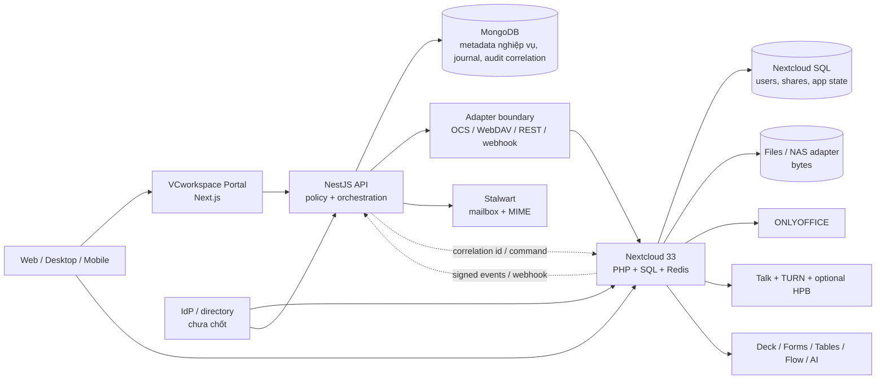
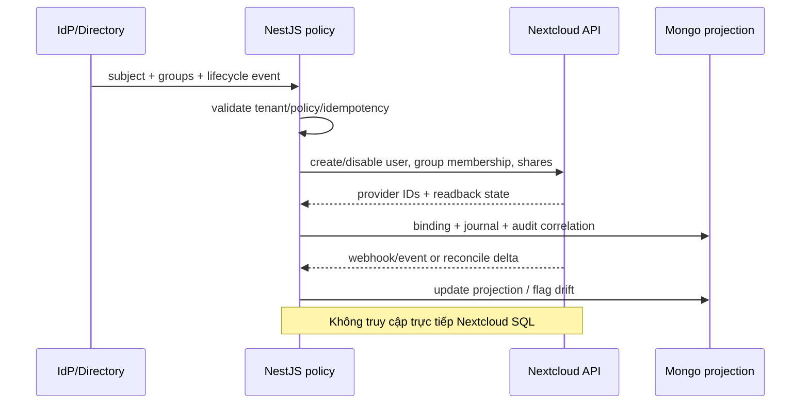

# VCworkspace 11 — lộ trình đủ 9 nhóm chức năng

- Ngày kiểm: **2026-10-24** (Asia/Ho_Chi_Minh).
- Checkout: `/Users/apple/projects/VCdocs`, nhánh `claude/nghien-cuu-vcworkspace`.
- Phạm vi: khảo sát read-only và thiết kế; không cài app, đổi hợp đồng, chạy
  production, mua dịch vụ, dùng dữ liệu/danh tính thật hoặc đọc `.env`.
- Cách đọc trạng thái: **LOCAL PASS** = đã chạy trên runtime local ở chat 01–10;
  **DOC** = nguồn chính thức mô tả nhưng repo chưa thử; **PoC** = cần chạy thử;
  **NOT_TESTED** = chưa có bằng chứng. Tài liệu/app-store không thay bằng chứng
  runtime, và PoC local không chứng minh production-ready.

## 1. Kết luận 20–80

Không nên viết lại một “Google Workspace” mới. Lộ trình ít rủi ro nhất là giữ
portal Next.js + NestJS + MongoDB làm lớp nghiệp vụ/điều phối VCworkspace, dùng
Nextcloud Community cùng app OSS làm nền cộng tác, và nối hai bên qua API chuẩn,
WebDAV/OCS, webhook/event hoặc adapter. **Không ghi trực tiếp DB hay data directory
của Nextcloud.**

Chat 01–10 đã chứng minh LOCAL ba lõi: Files/Drive; Office DOCX/XLSX/PPTX qua
ONLYOFFICE; Email Stalwart và liên thông Email–Drive–Office. Chúng chưa chứng
minh Sync mobile/desktop, Talk, Calendar/Contacts, bộ Work management, Flow,
Assistant AI hay Admin/SSO/audit production. Vì vậy trạng thái đúng là **3 nhóm
có lát cắt local, 6 nhóm còn DOC/PoC/NOT_TESTED**, không phải “đã đủ 9 nhóm”.

Mặc định đề xuất cho bước tiếp theo: **không cài app mới vào runtime 33.0.5 đang
giữ bằng chứng**. Chat 12, nếu được duyệt, tạo clone/stack local riêng và đưa nó
lên maintenance **33.0.10** trước khi thử app; ghim version suốt một ma trận.
Theo lịch chính thức ngày kiểm, 35.0.2 là latest, 33.0.10 vẫn maintained đến
2027-02. Sau PoC phải có kế hoạch nâng major, không ghim 33 lâu dài.
Phần mềm OSS có thể không thu phí bản quyền, nhưng vẫn có chi phí máy chủ, lưu
trữ, băng thông, GPU, sao lưu, giám sát, bảo mật, nâng cấp và nhân sự vận hành.
Không cam kết ngang Enterprise, SLA hay support thương mại.

## 2. Ma trận 9 nhóm: có, thiếu và điểm nghiệm thu

| # | Nhóm | Thành phần mặc định | Hiện có trong repo/runtime | Thiếu / trạng thái | Acceptance trước khi gọi là đạt |
|---|---|---|---|---|---|
| 1 | Files, kể cả NAS | Nextcloud Files + Team Folders + External Storage; adapter VCworkspace | **LOCAL PASS:** upload/download/hash, ACL A/B, version, move, trash/restore, usable backup/restore trên Nextcloud 33.0.5 | NAS/SMB thật, file lớn, Unicode/case, scan ngoài Nextcloud **NOT_TESTED** | SMB/NAS thử riêng; hai chiều theo chính sách; rename không mất metadata; ACL trực tiếp + qua API; restart/backup/restore; đo file đại diện và lỗi NAS |
| 2 | Sync desktop/mobile | Nextcloud Desktop, Android/iOS, WebDAV | Web UI/API đã chạy; không có client sync | **DOC/NOT_TESTED**; chưa offline conflict, selective sync, camera upload, MDM, revoke thiết bị | 2 desktop + 2 mobile thật; offline/edit/conflict; selective sync; app password/revoke; mất thiết bị; NAS deep-change; không rò dữ liệu sau offboard |
| 3 | Office/coediting | ONLYOFFICE Document Server + connector/adapter | **LOCAL PASS:** DOCX/XLSX/PPTX, edit/view, save/reopen, version, PDF; image 9.4.0.1 | Coediting nhiều người, 48 user, fidelity phức tạp, mobile **NOT_TESTED** | 3–5 người đồng biên tập; reconnect/conflict; callback stale; font/template; 20–30 file nghiệp vụ; tải và license review |
| 4 | Talk | Nextcloud Talk 23.0.11; coTURN; HPB OSS signaling + Janus khi cần | Chưa cài/chưa chạy | Chat/voice/video/screenshare là **DOC**; NAT/TURN/HPB, guest, recording, mobile **NOT_TESTED** | Chat/file ACL; call 1:1 và nhóm qua 4G/NAT; screenshare; guest/lobby; TURN TLS; test quy mô human chốt; mất mạng/rejoin; bandwidth/CPU; audit/retention |
| 5 | Groupware | Stalwart 0.16.27 + Nextcloud Mail; Calendar 6.6.3; Contacts 8.9.2 | **LOCAL PASS một phần:** mail gửi/nhận, MIME, labels/search/filter/alias/shared ACL/offboard | Calendar/Contacts/CalDAV/CardDAV/mobile và provisioning tích hợp **NOT_TESTED** | Mail giữ gate chat10; lịch mời/room/resource/timezone; contact/group; desktop/mobile sync; offboard; backup/restore; không đổi MX trong PoC |
| 6 | Work management | Deck 1.17.8, Notes 6.1.0, Forms 5.3.6, Tables 2.3.2, Collectives 4.7.1 | Không có runtime proof | Release metadata ghi range gồm NC33; toàn bộ **DOC/NOT_TESTED** cho repo | 2 phòng dùng board/note/form/table/wiki; share/ACL/comment/attachment; export/backup; ownership transfer/offboard; tìm kiếm; API/event; không coi là parity Jira/Notion/Sheets |
| 7 | Flow | Flow engine tích hợp Nextcloud + action app đã xác minh; webhook/custom adapter VCworkspace | Repo có jobs/idempotency riêng, chưa nối Flow | Engine Flow là **DOC**; workflow thật **NOT_TESTED**. External App Flow/Windmill cũ đã deprecate từ NC33 | 3 flow có implementation rõ ở mục 3.1; retry/idempotency/audit; quyền người chạy; timeout/rollback; replay không nhân đôi |
| 8 | Assistant AI | Nextcloud Assistant 3.5.1 + provider local; Context Agent 2.9.1; gateway/policy VCworkspace | Chưa cài/chưa chạy | UI/tooling là **DOC**; chất lượng tiếng Việt, ACL/RAG, CPU/GPU **NOT_TESTED** | Chỉ đọc/tóm tắt/soạn nháp trước; corpus A/B chống vượt ACL; citation; prompt injection; audit/consent; CPU baseline rồi GPU option; tool ghi/gửi/xóa cần xác nhận |
| 9 | Admin | Nextcloud accounts/groups, LDAP/OIDC/SAML candidate, Team Folders, admin_audit; portal policy/audit | Repo có tenant/session/CSRF/quyền/audit; principal revoke mail local | Unified identity, SSO, SCIM/provisioning, group lifecycle, audit hợp nhất **NOT_TESTED** | One identity ID; joiner/mover/leaver; group→ACL; session/device revoke; MFA/SSO; admin separation; audit correlation; restore; không sửa DB NC trực tiếp |

## 3. Component/version/license/dependency đã kiểm

Phiên bản dưới đây là **candidate tương thích Nextcloud 33 tại ngày kiểm**, không
phải lệnh cài. Trước mỗi PoC phải chụp lại App Store, checksum/image digest và
license của đúng artifact vì các kênh stable còn thay đổi.

| Component | Candidate cho NC33 | License/nguồn | Phụ thuộc và lưu ý |
|---|---:|---|---|
| Nextcloud Server | evidence runtime 33.0.5; candidate PoC 33.0.10 | AGPL-3.0; [lịch release chính thức](https://github.com/nextcloud/server/wiki/Maintenance-and-Release-Schedule) | 33.0.10 phát hành 2026-10-15, EOL dự kiến 2027-02; 35.0.2 là latest ngày kiểm. Clone/nâng maintenance riêng, không sửa runtime evidence |
| Files / Team Folders | core / 21.0.15 | AGPL; [Team Folders releases](https://apps.nextcloud.com/apps/groupfolders/releases) | ACL nhóm; VCworkspace chỉ gọi API/WebDAV/OCS |
| External Storage | bundled, bật theo PoC | AGPL/core; [admin docs](https://docs.nextcloud.com/server/stable/admin_manual/configuration_files/external_storage_configuration_gui.html) | SMB nên có php-smbclient; thay đổi trực tiếp ngoài NC cần notify/scan; rename ngoài NC có thể mất metadata |
| Desktop/mobile | client stable tại ngày PoC | GPL/app-store tương ứng; [docs overview](https://docs.nextcloud.com/) | WebDAV/app password, TLS; phải thử client thật và revoke |
| ONLYOFFICE Docs | runtime 9.4.0.1 | AGPL-3.0 + Section 7/trademark terms; [DocumentServer editions/license](https://github.com/ONLYOFFICE/DocumentServer/blob/master/Readme.md), [9.4 changelog](https://helpcenter.onlyoffice.com/docs/docs-changelog.aspx) | 9.4 bỏ cap 20 simultaneous opened documents, nhưng vendor vẫn khuyến nghị CE tối đa 20 users, không có mobile web editors/Admin Panel/cluster/support thương mại; tích hợp portal cần legal review AGPL/branding |
| Talk | candidate 23.0.11 | AGPLv3+; [release metadata](https://apps.nextcloud.com/apps/spreed/releases) ghi `>=33.0.0,<34.0.0` | Candidate chưa cài; coTURN, P2P nhỏ, HPB/SFU khi lớn; screenshare là tính năng app nhưng chưa PoC |
| Talk HPB OSS | chọn tag sau PoC preflight | AGPL-3.0; [signaling repo](https://github.com/strukturag/nextcloud-spreed-signaling) | signaling + Janus + NATS; TURN riêng; bản partner/support là quyết định thương mại khác |
| coTURN | >=4.5.0.8, chọn stable khi PoC | BSD-3-Clause; [Talk TURN docs](https://nextcloud-talk.readthedocs.io/en/latest/coturn/) | UDP/TCP/TLS, public IP/DNS/cert, bandwidth |
| Stalwart | runtime 0.16.27 | AGPL-3.0; [repo](https://github.com/stalwartlabs/stalwart) | SMTP/IMAP/JMAP/Sieve; mail engine tách Nextcloud Mail client |
| Calendar / Contacts | 6.6.3 / 8.9.2 | AGPLv3+; [Calendar releases](https://apps.nextcloud.com/apps/calendar/releases), [Contacts releases](https://apps.nextcloud.com/apps/contacts/releases) | Release listings gồm NC33; CalDAV/CardDAV, cron, mail invitations, resource calendars vẫn phải PoC |
| Deck / Notes | 1.17.8 / 6.1.0 | AGPLv3+; [Deck releases](https://apps.nextcloud.com/apps/deck/releases), [Notes 6.1.0 metadata](https://apps.nextcloud.com/apps/notes/releases) | Deck listing NC33=1.17.8; Notes range `>=33,<37`; Files/activity/notifications chưa PoC |
| Forms / Tables / Collectives | 5.3.6 / 2.3.2 / 4.7.1 | AGPLv3+; [Forms 5.3.6 metadata](https://apps.nextcloud.com/apps/forms/releases), [Tables 2.3.2 metadata](https://apps.nextcloud.com/apps/tables/releases), [Collectives 4.7.1 metadata](https://apps.nextcloud.com/apps/collectives/releases) | Các range lần lượt gồm NC33 (`Forms >=32,<35`; `Tables >=33,<37`; `Collectives >=31,<34`); vẫn preflight trên clone trước cài |
| Flow | engine server 33; Forms→Deck 0.7.0; workflow_script 4.0.1 chỉ candidate | AGPL/core; [automation docs](https://docs.nextcloud.com/server/stable/admin_manual/automation_overview/index.html), [Forms→Deck metadata](https://apps.nextcloud.com/apps/forms_deck/releases), [workflow_script](https://apps.nextcloud.com/apps/workflow_script) | Forms→Deck có trigger/action thật và range `>=33,<36`; event→Nest cần webhook/custom adapter; workflow_script phải PoC an toàn, không mặc định bật shell tùy ý |
| Assistant | 3.5.1 | AGPL-3.0; [release metadata](https://apps.nextcloud.com/apps/assistant/releases) ghi `>=33,<35` | Chỉ UI/task broker; cần provider AI; chưa cài |
| Context Agent | candidate 2.9.1 | MIT; [release metadata](https://apps.nextcloud.com/apps/context_agent/releases) liệt kê 2.9.1 dưới NC33 | App Store chưa được runtime preflight trong repo; AppAPI/ExApp/provider; nếu metadata tải về không xác nhận range NC33 thì dừng, không ép cài; tool quyền cao phải policy và audit |
| Local LLM | chọn đúng release tương thích khi PoC | nguồn mở; [requirements](https://docs.nextcloud.com/server/stable/admin_manual/ai/app_llm2.html) | x86_64 AVX/AVX2; >=12 GB RAM; CPU khuyến nghị 10–20 core hoặc NVIDIA >=8 GB VRAM/CUDA; nên máy tách |
| LDAP / OIDC / audit | bundled LDAP/admin_audit; OIDC app chọn sau | AGPL; [LDAP](https://docs.nextcloud.com/server/stable/admin_manual/configuration_user/user_auth_ldap.html), [audit](https://docs.nextcloud.com/server/stable/admin_manual/configuration_server/logging_configuration.html) | IdP và source-of-truth cần human chốt; không dùng hai ID rời cho cùng người |

### Giới hạn phải mang vào thiết kế

- NAS không phải “gắn là xong”: filecache có thể stale nếu người dùng sửa trực
  tiếp trên NAS; scan định kỳ gây trễ/tải, và rename ngoài Nextcloud có nguy cơ
  mất share/tag/comment/activity. Mặc định: chỉnh sửa qua Nextcloud; SMB thật dùng
  notification nếu đạt, còn NAS khác phải định nghĩa SLA scan.
- Talk P2P tăng băng thông theo số người. Tài liệu ước tính khoảng 1 Mbit/s mỗi
  luồng video; trên 5–20 người nên đánh giá HPB/SFU. TURN cần cho NAT/firewall và
  vẫn tiêu tốn bandwidth. Quy mô họp là quyết định human trước sizing.
- AI local “miễn phí license” không phải “miễn phí compute”. CPU phù hợp baseline
  ít người nhưng có thể chiếm toàn bộ core; GPU là lựa chọn sau đo chất lượng,
  latency, concurrency và tiếng Việt.
- SSO không tự bảo đảm ACL. Identity mapping, group membership, Team Folder,
  portal role và mail/calendar ACL phải có cùng lifecycle, deny test và audit ID.
- ONLYOFFICE 9.4 bỏ giới hạn 20 **simultaneous opened documents** cũ, không có
  nghĩa “vô hạn user/tải”. Một concurrent active user là người đang mở editor
  (kể cả view trong phép đo sizing); connection không đồng nhất tài khoản đăng
  ký. CE được vendor mô tả cho nhóm nhỏ, khuyến nghị tối đa 20 users; mobile web
  editing, cluster/Admin Panel và support khác theo edition. AGPLv3 kèm điều
  khoản Section 7/branding cần pháp chế xem đúng cách phân phối/tích hợp portal;
  chat11 chưa thực hiện legal review.

### 3.1 Flow: cái có sẵn và cái phải viết

| Acceptance | Trigger/action thật | Phần phải viết hoặc PoC |
|---|---|---|
| Upload → gắn tag/kiểm soát truy cập | Flow core + automated tagging/file access control; rule theo MIME, group, path/tag | Cấu hình rule, restricted tag, deny test; notify nếu cần phải chọn action app cụ thể, không giả định core tự gửi |
| Form → thẻ Deck | `forms_deck` 0.7.0 bắt sự kiện submit và tạo card bằng quyền user; cần Forms + Deck | Preflight NC33, mapping field/tag/attachment, ACL người xem form/card, idempotency khi resubmit |
| Nextcloud event → NestJS | Nextcloud webhook/orchestration gateway có event envelope; Nest chưa có receiver trong chat11 | Chat14 viết adapter/endpoint ký xác thực, allowlist event, journal/idempotency/retry/readback; đây là **custom code**, không phải tính năng sẵn đã chạy |

Không dùng `workflow_script` để chạy shell tùy ý làm mặc định. Nếu PoC app này,
chỉ cho script cố định/allowlist trong container không secret và không egress.

## 4. Kiến trúc và ranh giới dữ liệu

Ranh giới bắt buộc:

1. Nextcloud SQL là dữ liệu nội bộ của Nextcloud; portal/NestJS **không query hay
   ghi trực tiếp**. Chỉ nâng cấp app/server bằng migration chính thức.
2. MongoDB giữ tenant, nghiệp vụ VCworkspace, idempotency/journal và binding
   `internalId ↔ providerId`; không sao chép toàn bộ ACL Nextcloud rồi để lệch.
3. Lệnh thay đổi quyền đi qua service có idempotency, readback và audit. Event từ
   Nextcloud cập nhật projection; reconcile định kỳ sửa drift hoặc khóa thao tác.
4. Byte ở Files/NAS; MIME gốc ở Stalwart; tài liệu Office lưu thành version Files.
   Không để portal dựng URL nội bộ hoặc giữ credential provider ở client.
5. Một immutable subject ID từ IdP ánh xạ sang account Nextcloud, portal và mail.
   Email/username đổi được, không làm khóa chính. Offboard phải revoke session,
   app password, device/token và quyền nhóm ở mọi engine.

### Luồng identity/ACL tối thiểu

## 5. Backlog chat 12+ theo phụ thuộc

Không tự mở các chat này. Mỗi chat mới cần điều phối/human mở và giữ data giả,
runtime cô lập, acceptance riêng; app docs không được dùng thay runtime proof.

| Thứ tự | Chat đề xuất | Phụ thuộc | Phạm vi/điểm dừng |
|---:|---|---|---|
| 12 | Identity/Admin foundation | chat11 + human duyệt gói dưới đây | Clone NC 33.0.10 riêng; IdP local giả; OIDC cho Nextcloud + portal; account/group lifecycle, Team Folders, revoke và audit correlation. Không chạm production identity |
| 13 | Work management | 12 | Deck/Notes/Forms/Tables/Collectives trên NC33; ACL, ownership transfer, export/restore, API/events; không custom UI lớn |
| 14 | Flow | 12–13 | Ba workflow acceptance, webhook NestJS, retry/idempotency/audit; không dùng thành phần deprecated |
| 15 | Sync + NAS | 12 | Desktop/mobile thật và một NAS/SMB giả lập trước; human chốt thiết bị/NAS thật mới làm live |
| 16 | Groupware Calendar/Contacts | 12 | CalDAV/CardDAV, invitations/resources, mobile, lifecycle; giữ mail gate cũ |
| 17 | Talk nhỏ | 12 | Talk + TURN, 1:1/nhóm nhỏ/screenshare/guest/mobile; chưa HPB nếu chưa có quy mô |
| 18 | Talk HPB/load | 17 + human quy mô | Chỉ mở khi quy mô họp yêu cầu; đo SFU/TURN/bandwidth và failover |
| 19 | Assistant AI read-only | 12–14 | CPU baseline, RAG ACL, citation/prompt injection/audit; human chốt GPU/cost trước tăng tải |
| 20 | Nghiệm thu 9 nhóm local | 13–19 | ma trận xuyên nhóm, fault/restart/backup/restore/offboard; báo NOT_TESTED; không suy production |
| 21 | Thiết kế pilot/production | 20 + quyết định human | sizing, cost, security, RPO/RTO, monitoring, legal/license, rollback; phiên vận hành riêng mới deploy |

### Gói đề nghị human duyệt để mở chat 12

Đây là quyền mới duy nhất cần xin sau chat11; không hỏi chọn production IdP.

- Tạo stack local/volume/DB **mới**, chỉ bind loopback; clone dữ liệu giả cần
  thiết hoặc khởi tạo rỗng. Giữ nguyên runtime evidence 33.0.5 của chat02–10.
- Pin Nextcloud 33.0.10 theo digest sau preflight; bật `admin_audit`, Team Folders
  bản NC33 và một OIDC app có metadata tương thích xác minh ngay trước cài.
- Dùng **Authentik OSS local** làm candidate IdP, pin stable/digest tại chat12;
  bốn persona `.test` (admin, manager A, member A, outsider B), ba group giả.
- Nối cùng immutable subject vào Nextcloud và portal test; không nối Stalwart,
  Google, domain thật, LDAP/AD thật, SMTP/MX hoặc dữ liệu thật trong chat12.
- Acceptance: login/logout; group→Team Folder ACL; direct API deny; rename email
  không đổi subject; joiner/mover/leaver; disable/re-enable; revoke session/app
  password; audit correlation ID; restart và backup/restore config thử.
- Giới hạn: không custom login UI lớn, không SCIM production, không HA/load,
  không deploy/push/mua support. Blocker compatibility phải báo, không ép cài.

**Recommendation:** duyệt gói local trên làm chat12. Human chỉ cần quyết định
“mở chat12 theo gói” hoặc sửa phạm vi; lựa chọn production identity vẫn hoãn tới
sau PoC.

## 6. Default routine và quyết định thật cần human

### Mặc định không cần hỏi lại trong PoC

- Dùng data/danh tính `.test`, loopback/internal network, port/volume riêng; giữ
  app/version pin trong từng chat và luôn test deny + restart + readback.
- Ưu tiên app OSS chính chủ/featured và API chuẩn; portal chỉ bổ sung nghiệp vụ
  thiếu, không làm lại toàn bộ UI của Nextcloud.
- AI bắt đầu read-only; Flow bắt đầu ba luồng nhỏ; Talk bắt đầu 1:1/nhóm nhỏ;
  NAS bắt đầu SMB giả lập. Không bật public share, mail Internet hay tool AI ghi.
- Mỗi chat ghi version/license/dependency, source URL, ngày kiểm và NOT_TESTED.

### Chỉ human/chủ dự án quyết định

1. NAS/model thật, giao thức, nơi đặt và việc người dùng có được sửa trực tiếp
   ngoài Nextcloud hay không.
2. Danh sách thiết bị desktop/mobile thật, MDM/BYOD và chính sách offline/wipe.
3. Quy mô cuộc họp đồng thời, khách ngoài, recording/retention và SLA; từ đó mới
   chọn HPB/SFU/TURN sizing hay hỗ trợ thương mại.
4. Production identity source (AD/LDAP/OIDC/SAML), MFA, domain, mapping account
   cũ và quyền quản trị tách biệt.
5. GPU hay CPU, mô hình AI, concurrency, dữ liệu được phép index và ngân sách.
6. Ngân sách hạ tầng/vận hành/support; topology production, vùng dữ liệu,
   backup/RPO/RTO, on-call và thời điểm pilot/cutover.

## 7. Bằng chứng repo và NOT_TESTED

Nguồn repo: [bàn giao chat10](vcworkspace-10-nghiem-thu-tong-the.md), các bàn
giao 02–09 và `poc/`. Kết quả cuối đã ghi: fake/fault/race 26/26; Office thật
3/3; Stalwart management 5/5; interop thật 1/1; full gate guard 44, BE 157 với
140 endpoint, FE 76. Phiên chat11 không chạy lại runtime và không dùng số cũ để
chứng minh cây tài liệu mới.

**NOT_TESTED chung:** app mới trên runtime 33.0.5; nâng NC33→34/35; NAS thật;
desktop/mobile; coediting/tải; Talk/TURN/HPB; Calendar/Contacts; Work apps; Flow;
AI local; unified SSO/provisioning; HA/SLA/monitoring; production backup/restore;
license/legal theo deployment thực; dữ liệu và người dùng thật.

## 8. Nguồn chính thức trọng yếu

- [Nextcloud maintenance schedule](https://github.com/nextcloud/server/wiki/Maintenance-and-Release-Schedule) và [release policy](https://docs.nextcloud.com/server/stable/admin_manual/release_schedule.html)
- [External Storage và filecache/scan](https://docs.nextcloud.com/server/stable/admin_manual/configuration_files/external_storage_configuration_gui.html)
- [Talk scalability](https://nextcloud-talk.readthedocs.io/en/latest/scalability/) và [TURN](https://nextcloud-talk.readthedocs.io/en/latest/coturn/)
- [Nextcloud automation/Flow](https://docs.nextcloud.com/server/stable/admin_manual/automation_overview/index.html)
- [Forms→Deck 0.7.0](https://apps.nextcloud.com/apps/forms_deck/releases) và [webhook workflows](https://docs.nextcloud.com/server/stable/admin_manual/webhook_listeners/budibase_workflows.html)
- [Nextcloud AI overview](https://docs.nextcloud.com/server/stable/admin_manual/ai/index.html) và [Local LLM requirements](https://docs.nextcloud.com/server/stable/admin_manual/ai/app_llm2.html)
- [ONLYOFFICE DocumentServer editions/license](https://github.com/ONLYOFFICE/DocumentServer/blob/master/Readme.md) và [9.4 changelog](https://helpcenter.onlyoffice.com/docs/docs-changelog.aspx)
- [LDAP backend](https://docs.nextcloud.com/server/stable/admin_manual/configuration_user/user_auth_ldap.html) và [admin audit](https://docs.nextcloud.com/server/stable/admin_manual/configuration_server/logging_configuration.html)
- Các trang App Store đã liên kết tại bảng component; kiểm ngày 2026-10-24.

