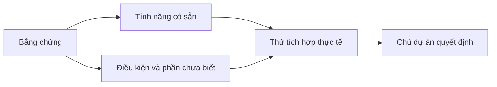
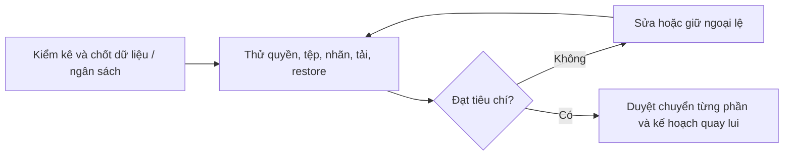
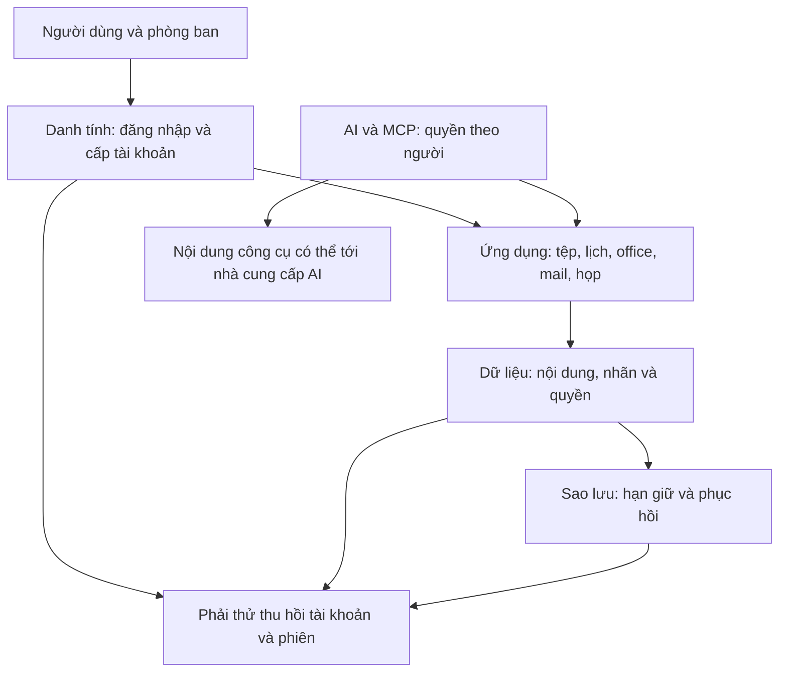
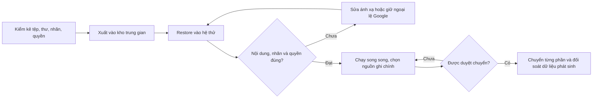

# VCworkspace — đọc theo ba mức cô đọng

**Ngày biên tập:** 2026-10-23. Hai vòng cùng áp dụng nguyên tắc Pareto 20–80: ưu tiên phần thông tin ảnh hưởng lớn nhất, cô đọng từ bản đầy đủ thành bản vòng 1, rồi cô đọng tiếp từ **bản vòng 1** thành bản vòng 2. Không thêm một đợt kiểm chứng nguồn mới.

| Mức đọc | Nội dung | Độ dài tham khảo |
|---|---|---|
| [20 của 20](#ban-20-cua-20) | Vòng 2: lõi của bản vòng 1 | 480 từ; 21.6% bản vòng 1, 4.4% bản đầy đủ |
| [20 của 100](#ban-20-cua-100) | Vòng 1: kết luận trọng yếu, điều kiện và quy trình | 2,227 từ; 20.5% bản đầy đủ |
| [100 của 100](#ban-100-cua-100) | Giữ nguyên hồ sơ đầy đủ: 48 ID, câu gốc, kết quả và nguồn | 10,865 từ; nội dung gốc không cắt sửa |

Số từ tính theo khoảng trắng, gồm bảng, sơ đồ và liên kết; tỷ lệ là xấp xỉ để kiểm mức cô đọng, **không phải thước đo đã giữ chính xác 80% tri thức**. Sơ đồ là cách đọc bằng chứng và quy trình cần thử, không mô tả hệ thống đã được triển khai. Bản đầy đủ giữ mốc kiểm chứng cũ; không tự cập nhật thành trạng thái hiện tại của repo hay dịch vụ.

---

## Version 20 của 20 — vòng cô đọng 2

**Cốt lõi:** tận dụng nền có sẵn và nghiệp vụ VCdocs, nhưng chỉ triển khai sau khi thử đúng quyền, dữ liệu, tải và phục hồi. Kiểm chứng tài liệu chưa chứng minh hệ thống chạy được và chưa thay quyết định của chủ dự án.

**48 luận điểm:** 21 xác nhận, 24 đúng một phần, một bị bác, hai chưa đủ bằng chứng. Hai điểm còn thiếu là **giá GCP Singapore đúng cấu hình** và **định danh “AI Jev”**. Đừng dùng bản cô đọng để biến các điều kiện thành lời bảo đảm.

### Bản đồ kiến thức cốt lõi

1. **Không cần tự xây mọi thứ.** Nextcloud có MCP; ONLYOFFICE CE từ 9.4 bỏ cap 20 kết nối; CODE mặc định không có cap 10/20. Nhưng có tính năng, có bản miễn phí hoặc có nhiều sao không chứng minh đủ tải, an toàn hay miễn nghĩa vụ giấy phép.
2. **Mail khó ở tính đúng, không chỉ gửi/nhận.** Nhãn Gmail, Twake Label API, tạo hộp thư trước login và thu hồi người nghỉ việc đều phải thử. Xuất Takeout mới tạo archive; rclone chưa bảo toàn mọi quyền. Phải restore và đối soát nhãn/nội dung/quyền trước chuyển.
3. **Tự host không đồng nghĩa dữ liệu ở lại máy mình.** Tool input/output có thể đi nhà cung cấp AI; không train khác không lưu. MCP ngoài Bash sandbox; SSO chưa tự giải quyết provisioning/offboarding. Quyền phải theo người và được thử thực tế.
4. **Chi phí và an toàn đều có điều kiện.** Chưa có giá GCP đúng vùng hay benchmark tiết kiệm RAM cố định. Object Lock không thay thử phục hồi; ngoại lệ cho dữ liệu chính người lao động lưu cloud không miễn mọi nghĩa vụ pháp lý.
5. **Giữ mã có giá trị, tách phụ thuộc.** Adapter Google tập trung nhưng Gmail, quyền Drive, login và schema vẫn còn. Test cũ không chứng minh kho mới hoặc toàn VCworkspace hoạt động.

### Quy trình ra quyết định

**Cần chốt:** nơi dữ liệu/AI được xử lý; nghiệp vụ bắt buộc; trần tiền; người vận hành; mức mất dữ liệu/gián đoạn chấp nhận. Chỉ chuyển khi kết quả thử đáp ứng các lựa chọn đó.

[Đọc sâu hơn: 20 của 100](#ban-20-cua-100) · [Tra bằng chứng: 100 của 100](#ban-100-cua-100)

---

## Version 20 của 100 — vòng cô đọng 1

**Giữ phần thông tin ảnh hưởng lớn nhất tới lựa chọn kiến trúc, tiền, dữ liệu và cách triển khai.** Tỷ lệ 20% là định hướng cô đọng; không phải bảo đảm giữ được 80% mọi chi tiết. Các ID dẫn về bản đầy đủ để tra điều kiện và nguồn.

### 1. Đọc kết quả đúng trước khi chọn công nghệ

Bàn giao cũ ghi 42 luận điểm nhưng dữ liệu gốc có **48 ID chưa hoàn tất kiểm chứng**: 41 của bảy mảng, sáu workspace và một nhãn thư. Kết quả là **21 xác nhận, 24 đúng một phần, một bị bác, hai chưa đủ bằng chứng**. Một câu “đúng một phần” có thể chứa mệnh đề con sai; không cộng nó vào nhóm đã đúng hoàn toàn.

Đây là đối chiếu nguồn và mã ngày 23/10/2026. **Tài liệu có tính năng ≠ phần mềm đã chạy đúng ≠ chủ dự án đã duyệt.** Chưa thử tải, di cư, restore hoặc xác minh hợp đồng thuê bao VCPV. Hai điểm chưa chốt được bằng chứng là giá GCP Singapore đúng SKU/CUD và việc “AI Jev” có phải Jev TypeSafe hay không. Một phần giá trị của kiểm chứng là bỏ những kết luận chắc chắn quá mức, không phải chỉ tăng số dấu xác nhận.

### 2. Bản đồ kiến thức: năm lớp phải nối được

Sơ đồ biểu diễn quan hệ cần kiểm, **không phải kiến trúc đã cài**. SSO chỉ giải quyết đăng nhập; chưa chứng minh hộp thư được tạo trước lần đăng nhập, người nghỉ việc bị thu hồi đủ quyền, hoặc bản sao dữ liệu được xoá/giữ đúng hạn.

### 3. Chọn nền cộng tác: có thể dùng sẵn, vẫn phải thử tích hợp

| Phần | Kết luận có giá trị quyết định | Điều không được suy ra |
|---|---|---|
| Nextcloud | Mail là client IMAP/SMTP; AIO có thể thêm mail server ngoài. Context Agent có MCP | Có Nextcloud không có nghĩa đã có trọn mail server và gateway đạt yêu cầu công ty |
| ONLYOFFICE CE | Từ 9.4 bỏ cap 20 kết nối, bỏ RabbitMQ/DB; vẫn có điều kiện giấy phép | Bỏ cap không chứng minh đủ tải 48 người hoặc mọi cách nhúng đều miễn nghĩa vụ |
| Euro-Office | Nextcloud/CryptPad đã tích hợp; có production distribution công khai | Enterprise support không đồng nghĩa paywall mọi binary production |
| Collabora CODE | Mặc định không có cap 10 tài liệu/20 kết nối; đó là Home Mode | Không có cap không thay cam kết hỗ trợ hay benchmark |
| Stalwart | Có giao thức mail/lịch, scheduling, iMIP, RSVP và free/busy | Chưa xác minh đủ UI và luồng đặt phòng/tài nguyên |
| Carbonio/grommunio | Tính năng và giới hạn phụ thuộc edition/gói hãng | Không đồng nhất giới hạn gói thương mại với cấm tự build mọi thành phần OSS |

Điểm loại phần mềm phải là nghiệp vụ, tải, vận hành và giấy phép thực tế. Grommunio Community được hãng cung cấp tới năm người; Carbonio CE thiếu bộ backup/HSM/legal hold thương mại nhưng không có nghĩa không sao lưu được bằng cách khác. Phải ghi đúng phạm vi câu kết luận. Tra [workspace-suites#1–6](#workspace-suites-1), [office-meet-calendar#1–6](#office-meet-calendar-1).

### 4. Mail và danh tính: nhãn, tạo người, nghỉ việc là ba bài thử riêng

**Nhãn Gmail không chỉ là “một thư nằm trong một thư mục”.** JMAP có keywords/mailboxes; Nextcloud Mail ánh xạ nhãn qua IMAP. Twake Mail có thêm Label API: cùng hỗ trợ JMAP chưa chứng minh Twake ghép Stalwart sẽ giữ được giao diện và hành vi nhãn. Với mỗi client, phải thử nhiều nhãn, tiếng Việt, tìm kiếm và đồng bộ. [mail-stacks#6](#mail-stacks-6).

Authentik có OIDC/SAML/LDAP/WebAuthn và SCIM cơ bản trong mã mở, nhưng OAuth authentication for SCIM và scheduled offboarding thuộc Enterprise. Đầu Stalwart lại yêu cầu Enterprise cho SCIM. **Đầu cấp có SCIM không có nghĩa đầu nhận dùng được miễn phí.** Stalwart OIDC chưa biết người chưa đăng nhập nếu chưa provision trước, nên thư đến có thể bị từ chối. Xoá người ở LDAP không tự xoá mailbox. Thử lần lượt: tạo người → nhận thư trước lần login → đổi quyền → đình chỉ → thu hồi phiên → xử lý mailbox theo hạn giữ. [security#1–2](#security-1).

Giá Stalwart 96 EUR/năm cho 48 hộp thư là phép tính từ bậc giá đã đọc, chưa gồm thuế xác định; dưới 150 hộp thư chưa có Premium Support. Không gộp mua tính năng với mua người chịu trách nhiệm hỗ trợ.

### 5. AI: tận dụng connector, kiểm quyền và luồng dữ liệu

Luận điểm “không có MCP mã mở trên 100 sao” **bị bác** bởi repo Nextcloud và CalDAV đã mở. Số sao không chứng minh an toàn hay độ chín. Nextcloud Context Agent có MCP server xác thực app-password; phần kết nối **ra MCP server ngoài** chưa hỗ trợ token riêng từng người và app chưa scale. Cần thử quyền, audit và phê duyệt trước khi quyết định viết thêm gateway; không mặc định viết lại tất cả. [workspace-suites#3](#workspace-suites-3), [ai-agents#6](#ai-agents-6).

Managed Agents chưa đủ điều kiện ZDR; self-hosted sandbox vẫn chuyển tool input/output qua control plane, workspace geo hiện chỉ `us`. Commercial Terms không cho dùng Customer Content để train, nhưng **không train ≠ không lưu**. Chính sách API 30 ngày có ngoại lệ theo tính năng/model; không áp chung cho mọi transcript. Scheduled tasks có thể dừng chờ duyệt, không phải mọi ghi đều tự chạy. [ai-agents#2–4](#ai-agents-2).

REA là công cụ phân tích; chạy local không chặn kết quả tool tới model. MCP nằm ngoài Bash sandbox. DISCLAIMER không sửa giấy phép MIT, cũng không cấp quyền với phần mềm bên thứ ba. CreatorOS được kiểm là SaaS có harness MIT, chưa phải toàn nền tự host. Có sản phẩm Jev TypeSafe nhưng chưa biết đó có đúng ý người dùng. n8n cho nghiệp vụ nội bộ theo điều kiện riêng, không coi là OSS OSI hoặc quyền bán lại vô điều kiện. [rea-creatoros#1–5](#rea-creatoros-1), [ai-agents#5](#ai-agents-5).

### 6. Di cư: xuất được dữ liệu chưa có nghĩa thay hệ thống thành công

Đây là quy trình thử đề xuất rút từ giới hạn công cụ, chưa phải cuộc di cư đã chạy. Vandelay `import takeout` nhập MBOX/ICS/VCF vào **SQLite archive offline**. Nó mô tả ánh xạ nhãn, gộp raw messages giống hệt và bỏ auto-category; còn bước restore sang server đích và kiểm nội dung thực tế. Không hứa giữ mọi nhãn và gộp mọi bản sao chỉ từ việc lệnh import thành công.

Data Export có Gmail/Drive/shared drives/Calendar/Contacts/Groups, nhưng cần đủ điều kiện super-admin, 2SV và subscription. Bucket Google cung cấp xoá sau **60 ngày từ khi bắt đầu export**. rclone xuất Docs/Sheets/Slides nhưng metadata quyền bỏ inherited permissions của shared drives và owner của My Drive; cần ánh xạ ACL riêng. Drive `files.export` giới hạn nội dung xuất 10 MB. [migration#1,3,5](#migration-1).

Gmail IMAP download có mốc 2.500 MB/ngày. Hạn LSA được blog chính thức cập nhật sang 01/5/2025; OAuth/app-password còn phụ thuộc tenant. Dual delivery cần đúng route, OU/group, loại thư và quy tắc spam; không mặc định bao phủ mọi thư. Chuyển MX cần đối soát phần thư phát sinh và tránh vòng lặp, không chỉ đổi DNS rồi coi đã quay lui được. [migration#2,6](#migration-2).

### 7. Bảo mật và pháp lý: cơ chế bảo vệ luôn có phạm vi

Cloudflare có arbitrary TCP nếu client/mạng được cấu hình phù hợp. Vì vậy IMAP/submission không bắt buộc công khai; MX nhận từ MTA Internet vẫn cần SMTP public hoặc gateway. Phải thử mail client, điện thoại, TLS và kết nối dài. Kopia có tài liệu Object Lock cho S3, Azure và GCS; B2 dùng S3 backend. Cấu hình retention, gia hạn lock và maintenance quyết định hiệu lực. **Khoá chống xoá không chứng minh backup đầy đủ hoặc phục hồi được.** [security#3–4](#security-3).

Pháp lý phải tách dữ liệu nhân viên khỏi khách hàng/đối tác trong thư và tệp. Điều 20(6)(b) Luật 91 có miễn riêng về đánh giá chuyển xuyên biên giới cho dữ liệu chính người lao động lưu cloud, không miễn mọi nghĩa vụ. Ưu đãi năm năm cho doanh nghiệp nhỏ theo các điều đã đọc **không liệt kê Điều 20 về CTIA ban đầu**. Luật An ninh mạng 2018 hết hiệu lực từ 01/7/2026 theo Điều 44 Luật 116; nghĩa vụ cụ thể và chuyển tiếp cần xét tiếp. Chưa kết luận VCPV được miễn hoặc mọi dữ liệu phải lưu VN. [security#5](#security-5), [phần Astra đầy đủ](#ban-100-cua-100).

Giấy phép phần mềm và hợp đồng SaaS phải đúng sản phẩm, phiên bản, vùng, cách sửa/phân phối/cung cấp. Google/Microsoft consumer terms không tự thay hợp đồng doanh nghiệp; clean-room không mặc nhiên hợp pháp trong mọi trường hợp. Không chuyển câu khuyến nghị sử dụng thành kết luận pháp lý chung.

### 8. Chi phí và tải: dùng phép tính để lập kịch bản, không làm lời hứa

Giá GCP Singapore đúng SKU/CUD chưa xác nhận; bảng Google tải ra mặc định Iowa không dùng cho Singapore. Business Standard 14 USD/user/tháng annual cho 48 người bằng 8.064 USD/năm, nhưng chưa biết hoá đơn VCPV; dự phóng ba năm giả định giá không đổi. Nextcloud Enterprise Standard từ 100 user không chứng minh mọi hỗ trợ partner đều có cùng tối thiểu. [sizing-cost#1–4](#sizing-cost-1).

Hetzner CCX33 Singapore được đối chiếu 174,49 EUR/tháng chưa IPv4/VAT, kèm 3 TB; không đủ để nói rẻ hơn GCP 25%. e2-medium duy trì tương đương tổng một vCPU, không phải hai core đầy đủ. Yêu cầu Wazuh server khác cả stack; CrowdSec không cùng chức năng để so RAM trực tiếp. Cũng không có benchmark cùng tải chứng minh Stalwart tiết kiệm cố định 6–14 GB so với Mailcow.

Ví dụ 900 GB egress chỉ đúng khi giả định trung bình 2,5 Mbit/s cho mỗi người nhận trong 80 giờ × 10 người; SFU, layers, screen share và TURN làm thay đổi kết quả. Talk có hướng dẫn tải, LiveKit/Meet có license và tính năng, Jitsi có kiến trúc phiên âm mới; tất cả chưa chứng minh cấu hình VM VCPV đủ tải. Lập kịch bản thấp/cơ sở/cao và đo cuộc họp mẫu. [sizing-cost#5–6](#sizing-cost-5), [office-meet-calendar#4–6](#office-meet-calendar-4).

### 9. Mã cũ: tái dùng có điều kiện, không chỉ thay URL

Ở commit được kiểm, SDK Google tập trung trong adapter, có **32 phương thức/8 cổng**, FE không gọi Google API trực tiếp. Nhưng FE còn login/sync/link/schema Google; Jobs → Notifications → Gmail và quyền Drive là phụ thuộc thực. VaultPort tách riêng, nhưng đổi S3 vẫn phải bảo toàn write-once, retention, xử lý lỗi và restore. Unique index dữ liệu là theo công ty, không phải toàn cục. [codebase#1–6](#codebase-1).

Bản đầy đủ ghi nhận 129 ca test khai báo và 98 thao tác API; đợt kiểm chứng ấy chưa chạy lại toàn bộ và chưa chứng minh adapter Google thật. Nhận định không có CI cũng gắn với checkout/commit được đọc, không đại diện các thay đổi quản trị AI sau đó. Giữ đúng mốc bằng chứng giúp tránh dùng thành công cũ để bảo đảm hệ mới.

### 10. Những gì phải giải quyết trước quyết định triển khai

| Cần chốt | Bằng chứng tiếp theo cần có |
|---|---|
| Nơi dữ liệu và AI được phép xử lý | Phân loại nội dung, luồng gốc/backup/log/tool I/O, hợp đồng và nghĩa vụ phù hợp |
| Nghiệp vụ phải giữ | Tệp mẫu, nhãn mail, quyền nhóm/khách ngoài, điện thoại, tạo/thu hồi người dùng |
| Tiền và tải thực tế | Hoá đơn Google, GB tệp/thư, người dùng đồng thời, họp/attachment, giá đúng SKU/vùng/thuế |
| Khả năng vận hành | Restore đã thử, mục tiêu mất dữ liệu/gián đoạn, người chịu trách nhiệm và cách đối soát khi quay lui |
| Phạm vi chưa biết | Định danh “AI Jev”, giá GCP Singapore; không lấp bằng suy đoán |

**Quy tắc đi tiếp:** dùng nguồn để chọn thứ cần thử; dùng kết quả thử để xin quyết định triển khai. Không lấy tính năng marketing, số sao, giá đơn lẻ hay test của VCdocs thay cho nghiệm thu toàn bộ VCworkspace.

[Đọc bản 20 của 20](#ban-20-cua-20) · [Tra nguyên văn và nguồn: 100 của 100](#ban-100-cua-100)

---

## Version 100 của 100 — hồ sơ đầy đủ giữ nguyên

Phần dưới đây giữ nguyên toàn bộ nội dung trước hai vòng cô đọng, kể cả ID, câu gốc, giới hạn và nguồn để tra cứu.

<!-- BEGIN ORIGINAL 100 OF 100 -->

# VCworkspace — hồ sơ kiểm chứng ngày 2026-10-23

Phần bổ trợ của [báo cáo khả thi](vcworkspace-nghien-cuu-kha-thi.md). Ngày theo giờ Việt Nam. Chủ dự án yêu cầu Sol High làm chính, Astra rà điểm khó; không phê duyệt xây dựng hoặc di cư qua yêu cầu này.

## Phạm vi và cách kiểm

- Dữ liệu bàn giao nói “42” nhưng danh sách khảo sát gốc gồm 41 ID của 7 mảng chưa bắt đầu + 6 workspace-suites đang dở + mail-stacks#6 = **48 ID** chưa hoàn tất. workspace-suites#2 đã có 1 lượt kiểm, 47 mục khác chưa kiểm. Giữ nguyên ID và nguyên văn câu gốc dưới từng kết quả, kể cả các câu lặp ONLYOFFICE/GCE; không gộp trùng để giảm số lượng.
- Sol High đối chiếu 13 ID cộng tác và 17 ID AI/di cư/REA; mã nguồn 6 ID được đọc tĩnh rồi Sol High rà độc lập. Astra High trực tiếp kiểm 12 ID bảo mật/pháp lý/chi phí và rà chéo các điểm khó của nhóm Sol. Không có cam kết hai model độc lập cho mọi ID.
- Chỉ dùng nội dung nguồn sơ cấp thực sự mở được hoặc mã trong checkout. Giá/version là ảnh chụp ngày đọc; nguồn master/latest không chứng minh mọi binary cũ có tính năng. Không tìm thấy không đủ để chứng minh một phủ định tuyệt đối.
- Kết quả câu gốc: **21 confirmed (✅), 24 partially (◐), 1 refuted (❌), 2 unverifiable (?)**. Partially có thể chứa mệnh đề con bị bác; số confirmed không có nghĩa sản phẩm đã được chứng nhận an toàn, hợp pháp hoặc đủ tải.
- Chưa cài/thử workload, di cư, đổi cấu hình Google/GCP hay kiểm hợp đồng thuê bao VCPV. Giá GCP Singapore và định danh “AI Jev” còn thiếu bằng chứng/dữ kiện; các PoC nêu dưới đây là việc tiếp theo.
- Nguồn khảo sát gốc: `ket-qua-da-xong.json` của workflow Claude `wf_d8f20636-759`, phiên `0153f5e4-10fe-4d4d-98d6-3915a62ea6bf`, ngày 22/10/2026; đọc từ thư mục local được sổ tay chỉ dẫn. Nội dung nguyên văn được giữ để truy vết nhận định, không coi các nguồn cũ chưa mở lại là đã kiểm mới.

## Sol High — cộng tác, office và nhãn thư

Ngày kiểm: **2026-10-23 (Asia/Ho_Chi_Minh)**. Phạm vi: 13 key_claims nguyên gốc; ID là vị trí 1-based trong `result.key_claims` của nhãn `khao-sat:...` trong `ket-qua-da-xong.json`. Đã đọc sổ tay và báo cáo hiện tại. Nhóm chỉ đọc; phiên chính tổng hợp và sửa tài liệu. Các URL dưới đây đều đã OPEN thành công và đọc phần liên quan, trừ nguồn lỗi được ghi riêng. “confirmed” xác nhận theo nguồn hiện hành; không có nghĩa đã cài đặt/đo tải/thử tương thích.

Tổng: **8 confirmed, 5 partially, 0 refuted toàn bộ, 0 unverifiable toàn bộ**. Một số mệnh đề con bị bác bỏ rõ ràng.

### workspace-suites#1 — confirmed (cần làm rõ AIO mặc định / container cộng đồng)

**Luận điểm gốc (nguyên văn khảo sát, chưa phải kết luận):** Nextcloud (kể cả Hub 26 Summer/NC 35 và AIO) không bao gồm mail server; app Mail chỉ là client IMAP/SMTP và nhãn thư là IMAP keywords.

**Câu dùng được:** Nextcloud Mail là ứng dụng thư kết nối hộp thư IMAP/SMTP; vẫn cần mail server. Nhãn hiển thị được ánh xạ sang IMAP keyword, tên/màu nằm trong ứng dụng. AIO có hướng dẫn thêm Stalwart bằng container cộng đồng; vì vậy không nói “AIO không thể có mail server”.

**Bằng chứng:** [Nextcloud Mail README](https://github.com/nextcloud/mail) nói kết nối IMAP và cài riêng Mail-in-a-Box/Stalwart/Dovecot. [AIO README, Mail server](https://github.com/nextcloud/all-in-one#mail-server) chỉ dẫn các server riêng và community container Stalwart. [Thiết kế nhãn của maintainer](https://github.com/nextcloud/mail/issues/4806) giải thích placeholder keyword IMAP; [manual Mail NC32](https://docs.nextcloud.com/server/32/user_manual/en/groupware/mail.html) xác nhận sửa/gán nhãn và màu. Thiết kế issue 2021 là bằng chứng cơ chế lịch sử, manual hiện hành xác nhận UI; không đo tương thích hai client.

### workspace-suites#2 — confirmed (theo gói sản phẩm công bố)

**Luận điểm gốc (nguyên văn khảo sát, chưa phải kết luận):** Tính đến 10/2026, grommunio Community miễn phí chỉ tối đa 5 user; từ user thứ 6 phải trả Basic €1,99/user/tháng (Plus €3,99, Business €5,49 từ 50 user).

**Câu dùng được:** Trang giá grommunio công bố Community miễn phí tới 5 người; Basic €1,99 và Plus €3,99/người/tháng từ 6 người; Business €5,49 từ 50 người. Mua qua partner. Với 48 người, giá niêm yết Basic/Plus lần lượt €1.146,24/€2.298,24 mỗi năm, chưa có báo giá/thuế/dịch vụ triển khai.

**Bằng chứng:** [Pricing và FAQ chính hãng](https://grommunio.com/pricing/) ghi rõ tất cả ngưỡng, giá và phân phối qua partner. Đây là giới hạn **gói phân phối/cung cấp của hãng**, chưa kiểm bằng mã rằng mọi component OSS có khóa kỹ thuật 5 người, cũng không là kết luận pháp lý cấm tự biên dịch.

### workspace-suites#3 — confirmed, có giới hạn quan trọng cho SSO từng người

**Luận điểm gốc (nguyên văn khảo sát, chưa phải kết luận):** Nextcloud Context Agent (ExApp) vừa expose tools của Nextcloud qua một MCP endpoint (xác thực app password) cho agent bên ngoài, vừa nhận thêm MCP server ngoài qua 'MCP Config' (chỉ streamable_http), theo tài liệu admin NC 35/36.

**Câu dùng được:** Context Agent có MCP server dùng app password và có thể nạp MCP server ngoài qua `MCP Config` với `streamable_http`. Cần AppAPI ≥3.1, deploy daemon và Assistant; chỉ dùng MCP server không cần model backend. Bản NC35 chưa scale được và chưa hỗ trợ MCP ngoài yêu cầu access token riêng cho mỗi người.

**Bằng chứng:** [NC35 stable manual](https://docs.nextcloud.com/server/stable/admin_manual/ai/app_context_agent.html) có đầy đủ endpoint `/index.php/apps/app_api/proxy/context_agent/mcp/`, Bearer app-password, ví dụ MCP Config, requirements và Known Limitations. [NC36 latest manual](https://docs.nextcloud.com/server/latest/admin_manual/ai/app_context_agent.html) cũng xác nhận MCP. NC35 manual footer phân biệt 36 upcoming /35 latest /34 stable; đường `stable` là alias thay đổi theo thời gian.

**Hệ quả cho báo cáo:** Không còn đủ cơ sở viết “chưa thấy MCP Nextcloud → phải tự viết gateway từ đầu”. Nên thử endpoint sẵn có, rồi mới thiết kế lớp bổ sung quản trị quyền/audit cho mail/lịch/ghi. Không suy từ có MCP sang đã đủ bảo mật/phân quyền nghiệp vụ VCPV.

### workspace-suites#4 — partially; mệnh đề CODE hard cap bị bác bỏ

**Luận điểm gốc (nguyên văn khảo sát, chưa phải kết luận):** ONLYOFFICE Docs Community Edition từ 9.4 đã bỏ giới hạn 20 tài liệu mở đồng thời (và bỏ RabbitMQ/DB), trong khi Collabora CODE vẫn là bản dev giới hạn 10 tài liệu/20 kết nối, không khuyến nghị production.

**Câu dùng được:** ONLYOFFICE Docs CE 9.4 bỏ giới hạn 20 kết nối và bỏ phụ thuộc RabbitMQ/DB. Collabora CODE mặc định hiện không có hard cap tài liệu/kết nối; **Home Mode** mới giới hạn 10 tài liệu/20 kết nối để tắt welcome/feedback popup. CODE vẫn là bản phát triển; cần cân nhắc bản có hỗ trợ cho nghiệp vụ quan trọng.

**Bằng chứng:** [Blog ONLYOFFICE 19/5/2026](https://www.onlyoffice.com/blog/2026/05/onlyoffice-docs-9-4) xác nhận CE, 20 connections, single process, bỏ RabbitMQ/database; [CHANGELOG](https://raw.githubusercontent.com/ONLYOFFICE/DocumentServer/master/CHANGELOG.md), mục 9.4 xác nhận. [Collabora maintainer vmiklos trả lời 10/9/2026](https://forum.collaboraonline.com/t/does-collabora-code-26-04-2-4-have-any-user-or-concurrent-connection-limits/5023) phân biệt default unlimited với Home Mode 10/20. Trang CODE/FAQ Collabora OPEN bị timeout/502; không coi nội dung search snippet là đã đọc nguồn. Không dùng giới hạn 10/20 làm lý do loại CODE.

### workspace-suites#5 — confirmed (ranh giới tính năng, không kết luận CE không sao lưu được)

**Luận điểm gốc (nguyên văn khảo sát, chưa phải kết luận):** Carbonio Community Edition không gồm Exchange ActiveSync (add-on trả tiền) và không có backup real-time/HSM/legal hold của bản thương mại.

**Câu dùng được:** Carbonio CE không bao gồm bộ ActiveSync, backup tích hợp, HSM và legal hold của bản hỗ trợ thương mại. Carbonio Email/Workspace bán ActiveSync như add-on. CE vẫn có thể dùng công cụ sao lưu ngoài hoặc tích hợp bên thứ ba; cần tự vận hành và thử phục hồi.

**Bằng chứng:** [Bảng editions chính hãng](https://zextras.com/editions) đánh CE ✕ ở backup, đồng bộ client ngoài, tiết kiệm lưu trữ/object storage. [CE page](https://zextras.com/carbonio-community-edition) yêu cầu chuyển sang supported edition nếu cần HSM/legal hold. [Carbonio platform](https://zextras.com/carbonio), phần editions, nêu real-time backup/HSM trong Email, ActiveSync add-on. CE page quảng bá ghi hình/co-edit trong khi bảng editions đánh một số tính năng ✕; đây là mâu thuẫn quảng bá riêng, không dùng để chứng minh CE đã đủ mọi tính năng.

### workspace-suites#6 — partially (giao thức/Enterprise xác nhận; thiếu bằng chứng phủ định tuyệt đối về webmail)

**Luận điểm gốc (nguyên văn khảo sát, chưa phải kết luận):** Stalwart v0.16.x (AGPL-3.0) hỗ trợ native CalDAV/CardDAV/WebDAV và OIDC bên cạnh JMAP/IMAP/SMTP, nhưng không ship webmail và các tính năng SCIM/multi-tenancy/AI spam thuộc Enterprise.

**Câu dùng được:** Stalwart hỗ trợ các giao thức nêu trên; Community AGPL-3.0 và Enterprise thương mại khác nhau ở SCIM, multi-tenancy và AI spam. Phải bố trí client thư/lịch; WebUI được tài liệu mô tả để quản trị/tự phục vụ tài khoản, chưa xác nhận là webmail đọc/soạn thư.

**Bằng chứng:** [README chính thức](https://raw.githubusercontent.com/stalwartlabs/stalwart/main/README.md) liệt kê protocol/OIDC và Web-based administration. [Compare editions](https://stalw.art/compare/) có mục Enterprise-only ghi SCIM, multi-tenancy và AI classifier. [FAQ](https://stalw.art/docs/faq/) mô tả WebUI quản lý account/settings/preferences, không phải bằng chứng tuyệt đối “không ship webmail”. [v0.16.27 release](https://github.com/stalwartlabs/stalwart/releases/tag/v0.16.27) ngày 18/10/2026 xác nhận dòng 0.16.x còn hiện hành. README/main và docs live có thể đi trước binary; cần pin phiên bản khi thử.

### office-meet-calendar#1 — confirmed, nhưng không suy 48 người đã được hãng khuyến nghị

**Luận điểm gốc (nguyên văn khảo sát, chưa phải kết luận):** ONLYOFFICE Docs Community Edition từ bản 9.4 (phát hành 5/2026) không còn giới hạn 20 tài liệu/kết nối đồng thời và chạy một tiến trình không cần RabbitMQ/DB.

**Câu dùng được:** ONLYOFFICE Docs CE 9.4 (19/5/2026) bỏ cap 20 simultaneous connections, hợp nhất backend một tiến trình, bỏ RabbitMQ/database. Trang so sánh vẫn khuyến nghị CE tới 20 người cho công việc không quá quan trọng; cần đo tải và quyết hỗ trợ trước dùng cho 48 người.

**Bằng chứng:** [Release blog chính hãng](https://www.onlyoffice.com/blog/2026/05/onlyoffice-docs-9-4), [CHANGELOG 9.4](https://raw.githubusercontent.com/ONLYOFFICE/DocumentServer/master/CHANGELOG.md); [trang compare hiện tại](https://www.onlyoffice.com/compare-editions) ghi `up to 20 recommended`, không phải hard cap. [Thông cáo Ascensio 20/5/2026](https://prtimes.jp/main/html/rd/p/000000047.000138312.html) đồng xác nhận. Changelog main đã có 10.0; thông tin 9.4 phải đọc theo section, không nói 9.4 là bản mới nhất.

**Bổ sung 2026-10-26 (đọc mã nguồn, kiểm lại theo yêu cầu "20 kết nối không đủ"):** `ONLYOFFICE/server` nhánh `release/v9.4.0`, `Common/sources/constants.js` vẫn giữ `LICENSE_CONNECTIONS = 20` cho gói có giấy phép nhưng thêm `LICENSE_CONNECTIONS_OS = 0x7fffffff`; `Common/sources/license.js` trả `connections`/`connectionsView = LICENSE_CONNECTIONS_OS` cho `PACKAGE_TYPE_OS` (bản mã mở không có tệp license). CHANGELOG 10.0.0 (phát hành 2026-10-12) không thêm lại giới hạn nào. Fork **Euro-Office** (`euro-office/server`, nhánh `main`, nền 9.3) đặt thẳng `LICENSE_CONNECTIONS = 99999`, `LICENSE_USERS = 99999`; bản production là Nextcloud Office Document Server v9.3.7 (`nextcloud-releases/Office-DocumentServer`, 2026-10-24). "20" còn lại chỉ là khuyến nghị số người dùng trên trang compare, không phải giới hạn kỹ thuật. Giá tham chiếu (chưa phải báo giá chính hãng, trang pricing ONLYOFFICE chỉ "get a quote"): đại lý ComponentSource niêm yết Enterprise 50 kết nối đồng thời ≈ 1.470 USD/năm (1 máy chủ, cập nhật 1 năm) hoặc ≈ 3.880,80 USD trọn đời (cập nhật 3 năm); Collabora Online for Business 3 EUR/người/tháng tới 99 người (trang pricing Collabora, 2026-10-26), CODE miễn phí nhưng "not recommended for production environments". Container PoC `vcworkspace-onlyoffice-chat04` lúc kiểm có `ds:docservice`/`ds:converter` FATAL (supervisorctl), nên chưa đọc được `/info/info.json` để đối chứng runtime.

### office-meet-calendar#2 — confirmed về tồn tại/tích hợp; có caveat phân phối production

**Luận điểm gốc (nguyên văn khảo sát, chưa phải kết luận):** Tính đến 10/2026, Nextcloud Office được 'powered by Euro-Office' — fork AGPL-3.0 của ONLYOFFICE do liên minh gồm Nextcloud, IONOS, Proton, Open-Xchange, OpenProject, XWiki... bảo trì trên github.com/euro-office — và CryptPad 2026.10 cũng dùng Euro-Office 9.3.

**Câu dùng được:** Nextcloud Office hiện dựa Euro-Office; tổ chức dự án xác nhận nền ONLYOFFICE/AGPL và liệt kê những tổ chức trên là contributors/supporters. CryptPad 2026.10.0 (21/10/2026) đã chuyển office apps sang Euro-Office 9.3. Euro-Office phân biệt community builds không ký phục vụ thử nghiệm/đóng góp với Nextcloud Office production distribution; bản production công khai không đồng nghĩa phải mua Enterprise, Enterprise là hỗ trợ chuyên nghiệp (Astra rà lại dưới đây).

**Bằng chứng:** [Nextcloud Office](https://nextcloud.com/office/) nêu powered by Euro-Office; [Euro-Office org README](https://github.com/euro-office) có fork, contributors/supporters, bảng builds; [CryptPad releases](https://github.com/cryptpad/cryptpad/releases), bản 2026.10.0, ghi Euro Office 9.3. Không diễn giải supporters thành tất cả cùng bảo trì mọi component. README Euro-Office cũng còn FAQ cũ nói chưa bán support trong khi phần Install nêu Enterprise; đã được Astra rà lại bằng tài liệu releases/distribution bên dưới; không suy từ Enterprise support thành paywall binary. Chưa cài binary production.

### office-meet-calendar#3 — partially; “không mô tả free/busy” sai

**Luận điểm gốc (nguyên văn khảo sát, chưa phải kết luận):** Stalwart (v0.16.x, 10/2026) hỗ trợ CalDAV Scheduling theo RFC 6638, gửi lời mời iMIP kèm .ics cho người nhận ngoài, có trang RSVP qua HTTP, và JMAP for Calendars; nhưng không có UI lịch/webmail và tài liệu không mô tả free/busy hay phòng/tài nguyên.

**Câu dùng được:** Stalwart có CalDAV Scheduling, iMIP `.ics`, HTTP RSVP, JMAP Calendars. Trang so sánh **có ghi free/busy lookup**. Chưa xác minh được luồng đặt phòng/tài nguyên và UI lịch đầy đủ; dùng client riêng và thử nghiệp vụ đặt lịch thật.

**Bằng chứng:** URL cũ `/overview` lỗi; URL hiện hành [Scheduling](https://stalw.art/docs/collaboration/scheduling/) xác nhận RFC6638/iMIP/RSVP, cập nhật 3/10/2026; [Calendar](https://stalw.art/docs/collaboration/calendar/) xác nhận JMAP/CalDAV; [Compare](https://stalw.art/compare/) liệt kê free/busy. Chỉ branding/template RSVP là Enterprise, không suy toàn bộ RSVP bị khóa Enterprise. Tài liệu nói mặc định tự thêm lời mời chỉ khi DMARC đạt + có sender trong address book; strict RFC behavior cần chỉnh `autoAddInvitations`.

### office-meet-calendar#4 — confirmed theo thông báo chính hãng, không là test bảo mật

**Luận điểm gốc (nguyên văn khảo sát, chưa phải kết luận):** Jitsi đã deprecate phiên âm qua Jigasi (blog 14/7/2026) và thay bằng opus-transcriber-proxy nhận audio từ JVB qua WebSocket, có thể trỏ tới endpoint STT tương thích OpenAI tự host để audio không rời hạ tầng.

**Câu dùng được:** Jitsi công bố kiến trúc JVB → WebSocket → opus-transcriber-proxy thay Jigasi cho transcription và deprecate luồng cũ. Có thể trỏ STT tương thích OpenAI tự host; bảo đảm audio nội bộ còn tùy cấu hình providers/failover và mạng.

**Bằng chứng:** [Blog Jitsi 14/7/2026](https://jitsi.org/blog/a-new-architecture-for-transcription-and-more/) giải thích đường audio, headers auth, provider backends và việc sẽ bỏ Jigasi transcription ở bản sau. Không có nghĩa mọi bản Jitsi cũ đã hỗ trợ hoặc Jigasi SIP cũng bị bỏ; chưa chạy thử endpoint STT.

### office-meet-calendar#5 — confirmed theo license + tính năng tài liệu

**Luận điểm gốc (nguyên văn khảo sát, chưa phải kết luận):** LiveKit server và LiveKit Agents là Apache-2.0; La Suite Meet (DINUM) là MIT, đã có ghi hình, chia sẻ nhiều màn hình, 100+ người, OIDC/SSO, còn phiên âm/tóm tắt ở trạng thái beta.

**Câu dùng được:** License repo LiveKit server/Agents là Apache-2.0; La Suite Meet là MIT. Tài liệu Meet đánh ghi hình, nhiều màn hình, OIDC/SSO và 100+ người available; transcription/AI summary beta. Đây là năng lực dự án, chưa phải kết quả tải trên cấu hình VM VCPV.

**Bằng chứng:** [LiveKit server LICENSE](https://github.com/livekit/livekit/blob/master/LICENSE), [Agents LICENSE](https://github.com/livekit/agents/blob/main/LICENSE), [Meet README](https://github.com/suitenumerique/meet), [DINUM documentation feature table](https://documentation-meet.beta.numerique.gouv.fr/overview/what-is-meet/). README nói recording/transcription còn thiếu hướng dẫn chi tiết; không xem trạng thái available như cài một bước.

### office-meet-calendar#6 — partially; sizing là ước tính, không phải trần/benchmark

**Luận điểm gốc (nguyên văn khảo sát, chưa phải kết luận):** Nextcloud Talk không có High Performance Backend chỉ đạt ~20 người khi mọi người tắt video, còn với HPB (nextcloud-spreed-signaling AGPL-3.0 + Janus + NATS) đạt 30–50+ người active; app live_transcription (Vosk) hỗ trợ tiếng Việt nhưng yêu cầu Nextcloud ≥33, HPB và ~16 GB RAM.

**Câu dùng được:** Talk P2P không HPB có thể khoảng 20 người audio-only khi mạng/thiết bị tốt; HPB/SFU thường 30–50+ active theo hướng dẫn. Live transcription dùng Vosk có tiếng Việt, yêu cầu NC≥33 và HPB mới; tài liệu ước 16 GB RAM cho 1–2 cuộc đồng thời và yêu cầu thử tải, không coi là tối thiểu cứng hay benchmark.

**Bằng chứng:** [Talk scalability](https://nextcloud-talk.readthedocs.io/en/latest/scalability/) dùng “could be doable”, “typically”; [signaling repo](https://github.com/strukturag/nextcloud-spreed-signaling) AGPL-3.0 và hướng dẫn Janus/NATS; [NC35 live_transcription](https://docs.nextcloud.com/server/stable/admin_manual/ai/app_live_transcription.html) nêu NC33, HPB sau 9/2025, Vosk Vietnamese, 4 CPU threads +2 mỗi cuộc đồng thời; tự nói còn rất ít kinh nghiệm production, sizing là estimates. Không đưa 30–50 thành bảo đảm cấu hình VM-B 4 CPU/8GB đủ cả transcription.

### mail-stacks#6 — partially; không suy mọi labels Twake tương thích Stalwart

**Luận điểm gốc (nguyên văn khảo sát, chưa phải kết luận):** JMAP (RFC 8621) cho phép một thư mang nhiều keyword tuỳ ý do người dùng đặt và keyword dùng chung với IMAP flags; Twake Mail và root-fr JMAP Webmail hiển thị nhãn/tag trên nền này, còn Roundcube chỉ có nhãn qua plugin bên thứ ba với bộ nhãn cố định.

**Câu dùng được:** RFC8621 cho mỗi Email tập keywords và chia sẻ với IMAP; từ khóa có ràng buộc ASCII/độ dài, tên nhãn tiếng Việt cần ánh xạ. root-fr có color labels. Twake Mail có UI labels nhưng dùng thêm `Label/get,set,changes`; phải thử khả năng server hỗ trợ extension này khi ghép Stalwart. Roundcube có plugin nhãn, không đủ cơ sở khẳng định mọi plugin chỉ có tập cố định.

**Bằng chứng:** [RFC8621 §4.1.1](https://www.rfc-editor.org/rfc/rfc8621.html#section-4.1.1), [root-fr README](https://github.com/root-fr/jmap-webmail), [Twake client CHANGELOG](https://github.com/linagora/tmail-flutter/blob/master/CHANGELOG.md), mục 0.24.0 ngày 27/1/2026 ghi Label methods; [backend maintainer issue #2172](https://github.com/linagora/tmail-backend/issues/2172) mô tả labels gắn keyword query view. [Thunderbird labels plugin README](https://github.com/mike-kfed/roundcube-thunderbird_labels) và [config](https://raw.githubusercontent.com/mike-kfed/roundcube-thunderbird_labels/master/config.inc.php.dist) cho phép chỉnh labels; không chứng minh mọi plugin bị hạn chế 5 nhãn. URL markup.co.uk của khảo sát không fetch được. Nhãn Gmail còn bao gồm semantics nhiều mailbox/label; keywords chưa tự chứng minh đạt tương đương Gmail.

### Các điểm Sol chuyển Astra — đã rà chéo trong phần Astra bên dưới

1. ONLYOFFICE CE 9.4: thay đổi cap có nguồn chính thức rất rõ; đừng giữ dữ kiện 20 hard cap cũ. Tách nó khỏi recommendation CE≤20 người và rủi ro hỗ trợ/bảo mật/tải 48 người. Giấy phép AGPL additional terms/trademark mới cần rà riêng, chưa có kết luận pháp lý ở đây.
2. Collabora CODE: không hard cap mặc định; Home Mode 10/20. Không dùng giới hạn cũ làm căn cứ trả phí bắt buộc.
3. Euro-Office: fork và Nextcloud/CryptPad tích hợp thật; community testing build và Nextcloud Office production distribution cần phân biệt; không mặc định Enterprise paywall binary. README còn phần FAQ support có vẻ chưa thống nhất.
4. Nextcloud MCP: có endpoint chính hãng; outbound MCP không có per-user access-token support và không scale. Phải đánh giá quyền khi dùng shared credential; chưa có bằng chứng an toàn/production chỉ vì docs có endpoint.
5. Twake labels: Label extension khác RFC8621 Email.keywords; không bảo đảm ghép Stalwart đạt UI labels. Cần kiểm tương thích trước chọn làm mặc định.

---

## Sol High — AI agent, di cư, REA

Ngày đọc nguồn trực tiếp: **2026-10-23 (Asia/Ho_Chi_Minh)**. Đối tượng là 17 `key_claims` gốc theo thứ tự trong `ket-qua-da-xong.json`, không lấy câu tóm tắt báo cáo thay cho luận điểm. Đã OPEN các URL nguồn sơ cấp bên dưới bằng web; kết luận là đối chiếu tài liệu, chưa chạy thử phần mềm/migration, chưa xác nhận hợp đồng riêng hoặc cấu hình tenant VCPV. Kết quả nhóm đã được tổng hợp vào báo cáo và sổ tay bởi phiên chính.

Tổng: **8 confirmed, 7 partially, 1 refuted, 1 unverifiable**. Mức partially có nghĩa câu gốc gộp cả phần đúng và phần thiếu/sai, không đồng nghĩa toàn bộ sai.

### ai-agents#1 — confirmed

**Luận điểm gốc (nguyên văn khảo sát, chưa phải kết luận):** Tính đến 10/2026, tính năng AI của Stalwart (LLM spam classifier và Sieve LLM integration/llm_prompt) chỉ có trong Enterprise Edition (giá theo hộp thư), không có trong Community Edition.

**Câu sửa:** Stalwart hiện xếp LLM spam classifier và tích hợp LLM trong Sieve (`llm_prompt`) vào Enterprise, tính phí theo hộp thư. Không đưa các tính năng này vào danh sách Community miễn phí.

**Bằng chứng:** trang Enterprise phần “AI-assisted spam filtering and Sieve scripting”; tài liệu LLM lines 685–687 ghi độc quyền Enterprise và không có trong Community. Đây là tính năng cụ thể, không suy rộng rằng mọi cách tích hợp AI bên ngoài đều bị cấm ở Community.

Nguồn đã đọc: https://stalw.art/enterprise/ ; https://stalw.art/docs/sieve/llm/

### ai-agents#2 — confirmed

**Luận điểm gốc (nguyên văn khảo sát, chưa phải kết luận):** Claude Managed Agents không đủ điều kiện Zero Data Retention; ngay cả self-hosted sandbox vẫn chuyển tool inputs/outputs qua control plane của Anthropic; workspace geo lưu trữ của Anthropic hiện chỉ có "us".

**Câu sửa:** Managed Agents đang beta (`managed-agents-2026-04-01`), chưa đủ điều kiện ZDR. Self-hosted sandbox giữ nơi thực thi tool/tệp ở hạ tầng mình, nhưng input/output tool vẫn tới control plane Anthropic; skills/memory stores cũng được Anthropic lưu. Workspace geo hiện chỉ có `us`; đây là lưu trữ/endpoint processing, khác với inference geo (`us` hoặc `global`).

Bằng chứng: overview line 180; self-hosted lines 90–98; data-residency lines 56–61, 120–122, 164–168. Không hứa dữ liệu ở Singapore chỉ vì VM nằm Singapore.

Nguồn: https://platform.claude.com/docs/en/managed-agents/overview ; https://platform.claude.com/docs/en/managed-agents/self-hosted-sandboxes ; https://platform.claude.com/docs/en/manage-claude/data-residency

### ai-agents#3 — confirmed, cần giữ ngoại lệ

**Luận điểm gốc (nguyên văn khảo sát, chưa phải kết luận):** Anthropic Commercial Terms cấm Anthropic huấn luyện trên Customer Content; API xoá input/output trong 30 ngày theo mặc định; Covered Models (Fable 5/5.1, Mythos 5/5.1) bắt buộc lưu 30 ngày và không được ZDR trừ khi Anthropic cho phép.

**Câu sửa:** Commercial Terms §B không cho Anthropic huấn luyện trên Customer Content. Theo Privacy Center, API mặc định xoá input/output trong vòng 30 ngày, **trừ** dịch vụ giữ lâu do khách hàng điều khiển, thoả thuận riêng, thực thi Usage Policy và nghĩa vụ pháp luật. Fable 5/5.1 và Mythos 5/5.1 là Covered Models, yêu cầu lưu 30 ngày và không ZDR trừ cho phép rõ ràng. Không áp câu “30 ngày” cho mọi sản phẩm/tính năng: Managed Agents lưu transcript tới khi xoá.

Bằng chứng: Commercial Terms hiệu lực 2025-06-17 line 54; Privacy Center 2026-07-01 lines 30–38; API retention lines 74–80, 147–162.

Nguồn: https://www.anthropic.com/legal/commercial-terms ; https://privacy.claude.com/en/articles/7996866-how-long-do-you-store-my-organization-s-data ; https://platform.claude.com/docs/en/manage-claude/api-and-data-retention

### ai-agents#4 — partially, cần sửa cơ chế quyền

**Luận điểm gốc (nguyên văn khảo sát, chưa phải kết luận):** Claude Code scheduled tasks (ex-routines) từ chối cron chạy dày hơn 1 lần/giờ, chạy dưới danh tính tài khoản cá nhân người tạo và dùng mọi connector (kể cả ghi) không hỏi lại.

**Câu sửa:** Scheduled tasks cloud vẫn từ chối cron dày hơn một lần/giờ, thuộc tài khoản cá nhân và thao tác qua các linked account của người tạo. Connector được chọn có thể đọc/ghi; tất cả connector hiện có được thêm mặc định khi tạo. Nhưng **không đúng khi nói mọi thao tác đều không hỏi lại**: phiên cloud mới thường bắt đầu auto mode, classifier quyết định cho/chặn; ask rule hoặc repeated-block threshold có thể khiến phiên dừng đợi người duyệt. Self-hosted và project thread có quy tắc riêng.

Bằng chứng: routines lines 151–173, 208–210, 248, 444–460. Đây là khác biệt trực tiếp so với câu gốc “including writes, without asking”.

Nguồn: https://code.claude.com/docs/en/routines

### ai-agents#5 — partially, kết luận dùng nội bộ vẫn đúng

**Luận điểm gốc (nguyên văn khảo sát, chưa phải kết luận):** n8n Sustainable Use License v1.0 cho phép dùng/sửa cho "internal business purposes"; chỉ các file có .ee. cần n8n Enterprise License; không được phân phối có thu phí.

**Câu sửa:** n8n Sustainable Use License v1.0 cho dùng/sửa cho nghiệp vụ nội bộ hoặc phi thương mại/cá nhân; phân phối/cung cấp cho người khác chỉ miễn phí và phi thương mại theo giấy phép này. Enterprise cần cho file chứa `.ee.` **hoặc thư mục chứa `.ee`**. Thành phần bên thứ ba giữ giấy phép riêng; LICENSE cũng loại nội dung nhánh khác `master`. Vì vậy không viết “chỉ các file .ee. cần Enterprise” như một mô tả đầy đủ. Đây là source-available, không mặc nhiên gọi là giấy phép nguồn mở OSI.

Bằng chứng: LICENSE lines 2–12, 13–31.

Nguồn: https://raw.githubusercontent.com/n8n-io/n8n/master/LICENSE.md

### ai-agents#6 — refuted

**Luận điểm gốc (nguyên văn khảo sát, chưa phải kết luận):** Không có MCP server mã nguồn mở nào cho IMAP/JMAP, CalDAV/CardDAV, Nextcloud hay Jitsi đạt trên 100 sao GitHub tính đến 10/2026; connector Gmail/Google Calendar trong knowledge-work-plugins là placeholder URL rỗng gắn với connector Google của Anthropic.

**Câu sửa:** Có MCP server mã mở trên 100 sao: ngày đọc, `cbcoutinho/nextcloud-mcp-server` hiển thị **391**, AGPL-3.0; `dominik1001/caldav-mcp` **103**, MIT. Phần placeholder đúng: productivity `.mcp.json` hiện có `google calendar` và `gmail` URL rỗng. Không dùng số sao để kết luận độ chín/bảo mật hoặc “bắt buộc tự viết gateway”; cần đánh giá và thử tích hợp.

Bằng chứng: đã OPEN repo trực tiếp, không dựa snippet hay không tìm thấy. Nextcloud README mô tả nhiều user qua Login Flow v2/OAuth và API Mail/Calendar/Contacts/WebDAV; chưa audit các cam kết ấy. Không khẳng định cấu hình placeholder tự nó chứng minh mọi chi tiết ràng buộc connector Anthropic.

Nguồn: https://github.com/cbcoutinho/nextcloud-mcp-server ; https://github.com/dominik1001/caldav-mcp ; https://raw.githubusercontent.com/anthropics/knowledge-work-plugins/main/productivity/.mcp.json

### migration#1 — confirmed, đây là nhập vào archive

**Luận điểm gốc (nguyên văn khảo sát, chưa phải kết luận):** Stalwart Vandelay `import takeout` đọc header X-Gmail-Labels trong MBOX của Google Takeout và ánh xạ mỗi nhãn tuỳ biến thành một JMAP mailbox, lưu một bản thư với tập mailbox là hợp của các nhãn (giữ trọn đa nhãn), bỏ qua Category labels.

**Câu sửa:** Vandelay `import takeout <PATH> <ARCHIVE>` nhập cây đã giải nén chứa MBOX/ICS/VCF vào **SQLite archive cục bộ, offline**, chưa phải tự nhập vào mail server đích. Theo docs, `X-Gmail-Labels` ánh xạ nhãn thường thành mailbox, trạng thái thành keyword, bỏ auto-category; bản thư có byte giống hệt được gộp theo BLAKE3, hợp tập mailbox từ các lần xuất hiện. Muốn dùng thực tế phải thêm bước restore/đẩy archive vào đích và PoC đa nhãn; không cam kết mọi bản sao có header/raw bytes khác đều được gộp.

Bằng chứng: Takeout docs lines 683–702, 743–772. Ghi “giữ đa nhãn theo tài liệu”, chưa ghi “đã kiểm bằng chạy thử”.

Nguồn: https://stalw.art/docs/migration/import-export/import/takeout/

### migration#2 — partially, mốc 14/3 đã bị thay

**Luận điểm gốc (nguyên văn khảo sát, chưa phải kết luận):** Tính đến 10/2026 Google giới hạn tải xuống qua IMAP 2.500 MB/ngày/tài khoản (khoá 1–24 giờ khi vượt) và từ 14/3/2025 chỉ chấp nhận app password hoặc OAuth 2.0 cho IMAP/CalDAV/CardDAV.

**Câu sửa:** Google hiện công bố IMAP download **2500 MB/ngày**; vượt hạn mức có thể tạm khoá thường 1 giờ, tới 24 giờ. OAuth được khuyến nghị, app password là ngoại lệ được hỗ trợ tuỳ chính sách tài khoản. Help còn ghi 14/3/2025 nhưng chính bài blog được Help dẫn “For exact dates” đã cập nhật 29/4/2025 rằng LSA ngừng **1/5/2025**. Không dùng 14/3 làm mốc cuối duy nhất.

Bằng chứng: bandwidth lines 299–313, 350–352; transition lines 57–74; blog update lines 74–79. Thực tế hiện tại không dùng mật khẩu tài khoản thường; cần xác nhận OAuth/app-password policy trên tenant.

Nguồn: https://knowledge.workspace.google.com/admin/gmail/gmail-bandwidth-limits ; https://knowledge.workspace.google.com/admin/sync/transition-from-less-secure-apps-to-oauth ; https://workspaceupdates.googleblog.com/2023/09/winding-down-google-sync-and-less-secure-apps-support.html

### migration#3 — confirmed, có điều kiện quản trị và thời hạn chính xác

**Luận điểm gốc (nguyên văn khảo sát, chưa phải kết luận):** Google Workspace Data Export (admin) xuất dữ liệu toàn tổ chức gồm Gmail, Drive kể cả shared drives, Calendar, Contacts và Groups mà không cần service account; sẵn sau ≥48 giờ, thường ~72 giờ, tối đa 14 ngày; lưu 60 ngày.

**Câu sửa:** Data Export full-org có ở mọi edition Workspace; gồm Gmail, Calendar, Contacts, Groups, Drive/shared drives. Quy trình Admin Console không đòi người dùng tạo key service account: cần super-admin đủ tuổi tài khoản (thường ≥30 ngày), 2SV, Google Cloud bật cho admin và subscription Workspace đang hoạt động cho dữ liệu core. Sẵn sớm nhất sau 48 giờ, thường 72 giờ, có thể 14 ngày. Bucket Google cung cấp xoá dữ liệu **60 ngày từ lúc bắt đầu export**, không từ lúc hoàn tất; bucket riêng là lựa chọn có điều kiện gói khác.

Bằng chứng: trang cập nhật 2026-10-20, lines 90–125, 151–180. “Resource” trong archive có thể là service account sở hữu dữ liệu; không nhầm với bắt khách hàng tự tạo key.

Nguồn: https://knowledge.workspace.google.com/admin/migrate/export-all-your-organizations-data

### migration#4 — confirmed cho chính sách, chưa xác nhận project vcdocs

**Luận điểm gốc (nguyên văn khảo sát, chưa phải kết luận):** Compute Engine chặn kết nối ra ngoài VPC trên TCP 25 (trừ một số project ngoại lệ), nên mail server trên VM vcdocs hiện tại phải gửi thư ra qua relay 587/465 hoặc qua MTA đặt ở nơi khác.

**Câu sửa:** GCE mặc định chặn egress TCP 25 tới IP ngoài VPC, có project ngoại lệ; 465/587 không bị Google chặn mặc định nhưng vẫn chịu firewall của khách hàng. Khi chưa xác nhận project được ngoại lệ, thiết kế gửi qua relay cổng thích hợp hoặc MTA khác. Không khẳng định đã thử project `vcdocs` và chắc chắn bị chặn.

Bằng chứng: sending-mail lines 541–545 nêu cả ngoại lệ và VPC/peering/on-prem tunnel; lines 550–554 nêu relay/non-standard port.

Nguồn: https://docs.cloud.google.com/compute/docs/tutorials/sending-mail

### migration#5 — partially, ACL không đầy đủ và bản chưa ghim

**Luận điểm gốc (nguyên văn khảo sát, chưa phải kết luận):** rclone (v1.75.2) xuất Google Docs/Sheets/Slides với --drive-export-formats mặc định docx,xlsx,pptx,svg, có thể đổi sang odt,ods,odp; hỗ trợ shared drives và --drive-metadata-permissions để đọc/ghi ACL dạng JSON; files.export của Drive API giới hạn 10 MB mỗi tệp xuất.

**Câu sửa:** Tài liệu rclone Drive hiện cho xuất mặc định `docx,xlsx,pptx,svg`, chọn `ods,odt,odp`, có shared drives. `--drive-metadata-permissions` đọc/ghi metadata quyền dạng JSON, mặc định off; **bỏ inherited permissions trên Shared Drives và owner permissions trên My Drives**. Không coi là bảo toàn ACL sang Nextcloud; cần ánh xạ người/nhóm/quyền và metadata store riêng. Drive `files.export` giới hạn **nội dung xuất 10 MB**, không phải kích cỡ tệp gốc. Chưa xác nhận các chức năng trên đúng nguyên trạng ở bản ghim v1.75.2.

Bằng chứng: rclone lines 394–404, 1062–1085, 1176–1184; Drive export 330–332.

Nguồn: https://rclone.org/drive/ ; https://developers.google.com/workspace/drive/api/reference/rest/v3/files/export

### migration#6 — confirmed, phải chọn đủ loại thư

**Luận điểm gốc (nguyên văn khảo sát, chưa phải kết luận):** Gmail Routing 'Also deliver to' + 'Change route' cho phép gửi bản sao mọi thư đến một server ngoài trong khi MX vẫn trỏ Google, cấu hình theo OU, hiệu lực tới 24 giờ.

**Câu sửa:** Khi Gmail là primary theo MX, Routing dual-delivery thêm recipient ở “Also deliver to” rồi “Change route” tới server ngoài; có thể áp OU/configuration group, thay đổi tối đa 24 giờ. Muốn bao phủ thư người dùng nhận phải cấu hình cả inbound bên ngoài và internal outbound theo mục tiêu. Spam/bounce và rules khác có thể thay đổi tập thư thực nhận; không viết “mọi thư” vô điều kiện.

Bằng chứng: dual-delivery lines 275–280, 293–327. Cần Gmail Settings administrator privilege và add route trước.

Nguồn: https://knowledge.workspace.google.com/admin/gmail/advanced/deliver-email-to-multiple-inboxes-with-dual-delivery

### rea-creatoros#1 — partially, phân biệt MIT và hướng dẫn sử dụng

**Luận điểm gốc (nguyên văn khảo sát, chưa phải kết luận):** 'REA — Reverse Engineer Anything' là repo GitHub morluto/rea (MIT, ~358.000 sao ngày 22/10/2026; npm rea-agents 6.7.0 phát hành 18/10/2026): một MCP server + skill bọc Ghidra/IDA/Hopper và công cụ ngoài, không tự có decompiler, không cần API key riêng, phân tích cục bộ, và DISCLAIMER.md cấm dùng để sao chép mã/tài sản độc quyền hay vượt DRM/license.

**Câu sửa:** `morluto/rea` là REA MIT, CLI/MCP + workflow instructions, phân tích native qua provider như Hopper/Ghidra/IDA; còn nhiều bộ phân tích static tích hợp. GitHub hiện hiển thị khoảng **367.2k sao** (23/10), không xác nhận lại số lịch sử 358k ngày 22/10. Release chính thức `rea-agents-6.7.0` ngày 18/10/2026, package.json phiên bản 6.7.0; npm registry bị tool từ chối nên không xác nhận metadata npm độc lập. Phân tích local **nhưng kết quả tool tới AI agent/model provider**. DISCLAIMER nêu dự án không hỗ trợ sao chép protected code/assets và né DRM; **nói rõ không sửa MIT và không thêm điều kiện bản quyền**. Chưa chứng minh không telemetry/API key cho mọi provider bằng audit mã.

Nguồn: https://github.com/morluto/rea ; https://raw.githubusercontent.com/morluto/rea/main/README.md ; https://raw.githubusercontent.com/morluto/rea/main/package.json ; https://github.com/morluto/rea/releases/tag/rea-agents-6.7.0 ; https://raw.githubusercontent.com/morluto/rea/main/DISCLAIMER.md

Caveat: main có thể mới hơn npm 6.7.0. Rà nguyên bản tag trước khi khẳng định feature có trong bản phát hành. Disclaimer lines 99–117 khẳng định không sửa licence, kể cả lịch sử. **Astra đã mở DISCLAIMER và xác nhận lại giới hạn MIT ở phụ lục rà chéo bên dưới.**

### rea-creatoros#2 — partially, phần lõi SaaS được xác nhận

**Luận điểm gốc (nguyên văn khảo sát, chưa phải kết luận):** 'Creator OS' là SaaS creatoros.ca của Kev Builds (@KevBuildsApps / GitHub kevinbadi): nền tảng lõi trả phí và không mã nguồn mở (Creators 14,99 USD/tháng; Ads add-on 19,99 USD/tháng cho Meta/Google/LinkedIn/TikTok/X/ChatGPT Ads), bài đăng đi từ máy chủ của họ ở Mỹ; chỉ harness/plugin (social-agents, creator-os-starter, creatoros-claude-plugin, ai-os-skills) là MIT và đều cần API key của họ.

**Câu sửa:** `creatoros.ca` quảng bá SaaS của founder @KevBuildsApps, giá solo **14.99 USD/tháng**; Ads add-on **19.99 USD/tháng** và API key riêng. Bài được đăng qua server dịch vụ; Privacy Policy 28/9/2026 nêu hosting/database ở Mỹ (Railway/InsForge), chia sẻ với hạ tầng publishing và AI providers. `kevinbadi/social-agents` là harness **MIT**, dùng CreatorOS làm dịch vụ bên dưới để đăng/trả lời/phân tích, không phải bản self-host toàn nền. Chưa kiểm đủ ba repo còn lại để nói “chỉ bốn repo này và tất cả MIT/cần key” hoặc loại trừ mọi Creator OS khác cùng tên.

Nguồn: https://www.creatoros.ca/ ; https://www.creatoros.ca/docs/ads ; https://www.creatoros.ca/privacy-policy ; https://github.com/kevinbadi/social-agents

Caveat: dùng giá/tính năng như công bố của nhà cung cấp, chưa test API/quảng cáo. Ads docs có cả LinkedIn trong tiêu đề nhưng phần connect cần kiểm riêng từng mạng/quyền/vùng. Không suy ra “vì SaaS ở Mỹ nên không nên dùng” như một sự kiện khách quan.

### rea-creatoros#3 — unverifiable về định danh người dùng, phần kỹ thuật xác nhận được

**Luận điểm gốc (nguyên văn khảo sát, chưa phải kết luận):** 'AI Jev' là Jev của TypeSafe AI — mô hình quyết định 'System One' proprietary, chỉ qua API (ra mắt 15/9/2026, 0,042 USD/1M input token, host tại Mỹ, không có weights), không sinh văn bản, không gọi tool, không phải agent hay trợ lý 24/7; Kev Builds (Creator OS) dùng Jev trong jev-voice, hyperedit và 'Jev chat', cho thấy ba cái tên đến từ cùng một nguồn.

**Câu sửa:** Một dự án tên **Jev của TypeSafe AI** ra mắt 15/9/2026 là mô hình System One đưa quyết định có kiểu, không sinh văn bản/viết code/hội thoại hay tự gọi tool như LLM agent. Docs models: Jev 1.14 ngày 14/10/2026, 0.042 USD/triệu input token, output free; `jev-latest` hiện vẫn trỏ 1.13 còn preview trỏ 1.14. MCA mô tả dịch vụ hosted/API có licence hạn chế. Nhưng **chưa xác nhận “AI Jev” người dùng nói chính là dự án này**, chưa chứng minh mối liên hệ ba cái tên từ cùng nguồn, vị trí inference Mỹ hoặc không có weights từ việc không tìm thấy. Giữ câu hỏi định danh, không kiến nghị Jev như quyết định đã chốt.

Nguồn: https://typesafe.ai/blog/introducing-system-one-models-and-jev ; https://docs.typesafe.ai/introduction/coding-agents ; https://docs.typesafe.ai/models ; https://typesafe.ai/legal/mca ; https://typesafe.ai/legal/data-processing

Caveat: thông cáo marketing “can't hallucinate” không dùng làm bảo đảm đúng; chính MCA nói output có thể sai. **Bản tổng hợp giữ chưa đủ bằng chứng về định danh người dùng; chưa coi là lựa chọn đã chốt.**

### rea-creatoros#4 — partially, điều khoản có hạn chế nhưng phạm vi không đồng nhất

**Luận điểm gốc (nguyên văn khảo sát, chưa phải kết luận):** Điều khoản dịch vụ của Google (hiệu lực 30/7/2026), Microsoft (30/9/2026), Adobe (3/10/2025) và CapCut (9/6/2020) đều cấm reverse engineering/decompile dịch vụ và phần mềm của họ, chỉ trừ phạm vi luật áp dụng bắt buộc cho phép (Adobe còn yêu cầu xin thông tin tương thích trước).

**Câu sửa:** Các trang đã đọc đều có hạn chế reverse/decompile, nhưng phải chọn hợp đồng đúng dịch vụ/vùng/thời điểm. Google ToS US hiệu lực 30/7/2026 hạn chế RE để lấy trade secret/proprietary info trừ luật cho phép. Google Workspace URL hiện là Google Cloud Terms sửa **12/10/2026**, §3.3(b) cấm RE/extract source trừ luật không cho hạn chế; trang ghi áp ở kỳ gia hạn tới, hợp đồng ký riêng có thể ưu tiên. Microsoft Services Agreement hiệu lực 30/9/2026 là **consumer** agreement, §8(b)(ii) có ngoại lệ luật bản quyền; không đại diện mọi enterprise product. Adobe 3/10/2025 §17 có hạn chế, yêu cầu xin thông tin trước khi decompile để tương thích theo luật. CapCut URL cũ là 9/6/2020; trang hiện tại 15/4/2026 là **US users**, không xác lập điều khoản áp dụng VCPV tại Việt Nam.

Nguồn: https://policies.google.com/terms ; https://workspace.google.com/terms/premier_terms/ ; https://www.microsoft.com/en-us/servicesagreement ; https://www.adobe.com/legal/terms.html ; https://sf21-draftcdn-sg.ibytedtos.com/obj/ies-hotsoon-draft-sg/capcut/via_clause_user_agreement_en.html ; https://www.capcut.com/clause/terms-of-service

Caveat: câu “cấm tuyệt đối mọi SaaS” là chính sách nội bộ đề xuất, không phải kết luận tất yếu pháp lý. Tự viết clean-room/học giao diện cũng không mặc nhiên hợp pháp trong mọi trường hợp; cần quyền cụ thể và hợp đồng. **Bản tổng hợp đã giữ các giới hạn sản phẩm/vùng/hợp đồng này. Sol đã mở các terms nêu trên; không tuyên bố Astra mở độc lập lại cả bốn hãng hay đã xác định hợp đồng VCPV.**

### rea-creatoros#5 — confirmed, khuyến nghị cách ly là đánh giá kỹ thuật

**Luận điểm gốc (nguyên văn khảo sát, chưa phải kết luận):** Sandbox Bash của Claude Code không bao phủ MCP server, file tool và hook ('MCP servers, and hooks run outside it'), và REA tự nhận 'This is not a sandbox' với các tool thực thi mã ngoài bằng quyền người dùng — nên cách ly phải ở tầng VM/container, không thể trông vào sandbox của Claude Code.

**Câu sửa:** Bash sandbox Claude Code chỉ bọc shell và tiến trình con; file/web tools theo permission riêng, local MCP server/hook/LSP/helper khác chạy ngoài với quyền user. SECURITY của REA nói không phải sandbox, không chống process độc cùng OS user; provider parse/analyse binary bằng quyền user. Vì vậy không coi việc bật Bash sandbox là cách ly REA. Chạy lab VM/container được cấu hình hạn quyền và không có credential công ty là khuyến nghị hợp lý, **không tự bảo đảm sandbox an toàn chỉ vì dùng container**.

Bằng chứng: Claude sandbox lines 101–130; REA SECURITY lines 20–40. REA có token per-session/IPC riêng và giới hạn resource/temp project, nhưng tự nói các biện pháp không biến Ghidra thành sandbox.

Nguồn: https://code.claude.com/docs/en/sandboxing ; https://raw.githubusercontent.com/morluto/rea/main/SECURITY.md

### Tác động đề nghị chuyển cho phiên tổng hợp

1. Bỏ “phải tự viết MCP Gateway vì không server nào >100 sao”; đã có phản ví dụ trực tiếp. Kiến trúc gateway vẫn có thể được chọn vì quyền/audit/chuẩn hoá, nhưng cần lý do riêng.
2. Sửa scheduled tasks “không hỏi quyền” thành auto mode có classifier và trường hợp phải chờ duyệt.
3. Sửa ngày LSA sang 1/5/2025 và ghi Help cũ mâu thuẫn với update chính thức.
4. Không hứa Takeout import là migration end-to-end; chưa restore/prove đa nhãn thực tế. Không hứa rclone bảo toàn ACL.
5. Phân biệt REA local với kết quả gửi model; MIT với chính sách hỗ trợ; bản main với release.
6. Giữ “AI Jev” chưa định danh; terms cần đúng hợp đồng/vùng. Bản tổng hợp đã giữ các giới hạn này; Astra rà lại ranh giới diễn đạt của báo cáo, không thay thế việc xác định hợp đồng thực tế hoặc định danh “AI Jev”.

---

## Mã nguồn — kiểm tĩnh và Sol High rà độc lập

### Mã VCdocs — Sol, kiểm tra tại checkout 2026-10-23

Phạm vi: nhánh `claude/nghien-cuu-vcworkspace`, commit `b8c8b805fce3ab831ac316d21343140b48d9b421`; kiểm tĩnh mã hiện tại, không suy rằng các nhánh khác hoặc production giống checkout này. `pnpm --filter @vcdocs/api typecheck` đạt (exit 0). Đếm AST: 32 phương thức trong 8 cổng; 129 ca test khai báo (127 lời gọi it/test đơn + 1 lời gọi it.each có 2 trường hợp), **không chạy lại 129 test**. 98 thao tác OpenAPI.

### codebase#1 — ✅ confirmed

**Luận điểm gốc (nguyên văn khảo sát, chưa phải kết luận):** Mọi lời gọi Google trong apps/api đi qua interface GooglePorts ở apps/api/src/google/ports.ts (Symbol GOOGLE, cung cấp bởi google.module.ts theo GOOGLE_MODE); không file nào ngoài apps/api/src/google/real/real-google.ts import gói @googleapis/*.
- Gốc: mọi lời gọi Google đi qua GooglePorts; chỉ real-google.ts import @googleapis/*.
- Kết quả: trong `apps/api/src`, tìm toàn bộ import SDK xác nhận chỉ adapter thật import 5 gói @googleapis. GooglePorts có 8 cổng (gồm UrlFetchPort là tải HTTPS tổng quát); GOOGLE được chọn fake/real bởi GoogleModule. Những lệnh CLI có thể gọi `createRealGoogle` trực tiếp để tạo adapter thay vì nhận qua DI — không nên hiểu mọi điểm khởi tạo đều inject GOOGLE.
- Bằng chứng: [ports.ts](../../apps/api/src/google/ports.ts#L164), [google.module.ts](../../apps/api/src/google/google.module.ts#L12), [real-google.ts](../../apps/api/src/google/real/real-google.ts#L3); [nap-so-do.ts](../../apps/api/src/nap-so-do.ts#L46). Kiểm tĩnh toàn cây `apps/api/src`; không chứng nhận hành vi Google thật.

### codebase#2 — ◐ partially

**Luận điểm gốc (nguyên văn khảo sát, chưa phải kết luận):** FakeGoogle (apps/api/src/google/fake/fake-google.ts:50) implements đủ 32/32 method của GooglePorts và toàn bộ 129 test e2e BE dựng app với GOOGLE_MODE=fake (test/support/app.ts:89); không có test tự động nào chạy bản real.
- Gốc: FakeGoogle đủ 32/32 method; toàn bộ 129 test dùng fake; không test real.
- Kết quả: FakeGoogle implements GooglePorts, đủ 32 method về kiểu; typecheck qua. createTestApp dùng GOOGLE_MODE=fake. Có một test CLI đặt GOOGLE_MODE=real để chạy khởi tạo công ty, nhưng `khoi-tao.ts` chỉ nạp cấu hình và ghi Mongo, không gọi adapter/API Google. Vì vậy đúng là chưa có kiểm thử tích hợp tự động với Google thật, sai khi nói không test nào đặt real. 129 là số ca khai báo, chưa phải kết quả chạy phiên này.
- Bằng chứng: [fake-google.ts](../../apps/api/src/google/fake/fake-google.ts#L50), [support/app.ts](../../apps/api/test/support/app.ts#L89), [khoi-tao.e2e-spec.ts](../../apps/api/test/khoi-tao.e2e-spec.ts#L86), [khoi-tao.ts](../../apps/api/src/khoi-tao.ts#L28).

### codebase#3 — ◐ partially

**Luận điểm gốc (nguyên văn khảo sát, chưa phải kết luận):** apps/web không gọi Google API nào; phụ thuộc Google ở FE chỉ là dựng link drive.google.com/open?id= và parse URL (apps/web/src/lib/drive.ts:2-12, components/ui.tsx:260, components/jobs.tsx:51, thu-muc/FolderBrowser.tsx:159) cùng trang 'Bộ nhớ dùng chung' (app/(app)/drive); mọi dữ liệu đi qua /api/v1 (api/client.ts:30).
- Gốc: FE không gọi Google API; chỉ URL builder/parse và trang shared drive, mọi dữ liệu qua /api/v1.
- Kết quả: không thấy Google SDK hay gọi trực tiếp Google API trong apps/web/src; client nghiệp vụ gọi /api/v1. Nhưng phụ thuộc Google còn ở đăng nhập `/auth/google`, đồng bộ `/sync/google`, nhãn và schema Google, URL mở file/thư mục. Giữ được phần lớn cấu trúc FE là suy luận hợp lý; không khẳng định giữ gần nguyên hoặc chỉ sửa vài URL khi chưa thiết kế hợp đồng kho mới.
- Bằng chứng: [client.ts](../../apps/web/src/api/client.ts#L30), [LoginBox.tsx](../../apps/web/src/app/dang-nhap/LoginBox.tsx#L21), [nhan-su/page.tsx](../../apps/web/src/app/(app)/nhan-su/page.tsx#L37), [drive.ts](../../apps/web/src/lib/drive.ts#L11), [FolderBrowser.tsx](../../apps/web/src/app/(app)/thu-muc/FolderBrowser.tsx#L159), [schema.d.ts](../../apps/web/src/api/schema.d.ts).

### codebase#4 — ◐ partially

**Luận điểm gốc (nguyên văn khảo sát, chưa phải kết luận):** Các dịch vụ hạ tầng audit.service.ts, jobs.service.ts, idempotency.interceptor.ts, session.service.ts, auth.guard.ts, tenant.plugin.ts, contract.interceptor.ts không import gì từ apps/api/src/google/ (jobs.service.ts chỉ dùng class GoogleError từ common/errors.ts:64 để quyết định thử lại).
- Gốc: audit/jobs/idempotency/session/auth/tenant/contract không import Google, dùng lại ngay.
- Kết quả: bảy file không import trực tiếp từ google/. Tuy nhiên JobsService phụ thuộc NotificationsService; NotificationsService inject GooglePorts và gửi Gmail. JobsService còn quyết định retry theo GoogleError, lỗi DRIVE_ERROR và thông điệp Google. AuthGuard phụ thuộc AccessService có khái niệm quyền drive. Tái sử dụng được sau khi tách notification/error/access adapter; không phải toàn bộ độc lập Google và bê nguyên dùng ngay. Chưa kiểm toán bảo mật/audit consistency.
- Bằng chứng: [jobs.service.ts](../../apps/api/src/jobs/jobs.service.ts#L7), [jobs retry](../../apps/api/src/jobs/jobs.service.ts#L177), [notifications.service.ts](../../apps/api/src/notifications/notifications.service.ts#L28), [Gmail send](../../apps/api/src/notifications/notifications.service.ts#L62), [auth.guard.ts](../../apps/api/src/common/auth.guard.ts#L6), [access.service.ts](../../apps/api/src/access/access.service.ts#L8). Các file còn lại đọc trực tiếp trong phiên.

### codebase#5 — ◐ partially

**Luận điểm gốc (nguyên văn khảo sát, chưa phải kết luận):** Kho PDF đã chốt đi qua VaultPort riêng (ports.ts:177-181) với FsVault/MemoryVault (google/vault.ts); nghiệp vụ chỉ gọi vault.put ở records.service.ts:279 (và evidence.service đọc ở nhánh giai-doan-2), nên đổi sang S3/MinIO không chạm logic chốt hồ sơ.
- Gốc: VaultPort riêng, đổi S3/MinIO không chạm logic chốt hồ sơ.
- Kết quả: VaultPort đúng là riêng (put/get/remove), FsVault/MemoryVault được inject độc lập với Google. Ở checkout này một vị trí nghiệp vụ ghi `vault.put` trong records.service.ts:279. Tuy nhiên adapter S3 cần bảo toàn write-once/idempotency, lỗi, retention/quyền xoá và thử phục hồi; không suy API S3 bảo đảm pháp lý 10 năm. Giai đoạn 2 dùng vault get/put/remove cho evidence — đã đọc bằng `git show giai-doan-2:apps/api/src/modules/m15-audit/evidence.service.ts`, không checkout hay đổi nhánh.
- Bằng chứng: [VaultPort](../../apps/api/src/google/ports.ts#L178), [vault.ts](../../apps/api/src/google/vault.ts#L6), [records.service.ts](../../apps/api/src/modules/m07-records/records.service.ts#L279), [GoogleModule](../../apps/api/src/google/google.module.ts#L19). Bằng chứng nhánh giai đoạn 2: evidence.service.ts dòng 92,100,166,191 ở ref local `giai-doan-2` (không thuộc checkout báo cáo).

### codebase#6 — ✅ confirmed

**Luận điểm gốc (nguyên văn khảo sát, chưa phải kết luận):** Deploy hiện tại không có CI/CD (không có .github/), chỉ 4 dịch vụ trong docker-compose.prod.yml, tường lửa chỉ mở 80/443 + IAP SSH, cập nhật bằng git pull + docker compose up --build tay (deploy/README.md:246-252); khái niệm Google nằm trong mô hình dữ liệu (Department.driveId unique, Folder.googleId unique) và lộ ra hợp đồng API.
- Gốc: không CI/CD trong repo; Compose 4 dịch vụ; deploy tay; driveId/googleId lộ trong DB và hợp đồng.
- Kết quả: checkout không có .github/, Compose có caddy/web/api/mongo, guide cập nhật git pull + compose build. Guide mở 80 TCP,443 TCP/UDP và IAP SSH; đây là cấu hình mẫu, chưa xác minh firewall máy thật hay CI ngoài GitHub. Department.driveId và Folder.googleId có unique index theo companyId (không unique toàn cục); schema API vẫn mang Google identifiers. Đổi backend đòi hỏi thiết kế lại mô hình/quyền và tương thích hợp đồng, không chỉ đổi adapter.
- Bằng chứng: [Compose](../../deploy/docker-compose.prod.yml#L7), [firewall mẫu](../../deploy/README.md#L99), [cập nhật tay](../../deploy/README.md#L246), [models.ts](../../apps/api/src/db/models.ts#L150), [OpenAPI](../../contract/openapi.yaml#L1721).

### Rà độc lập Sol High — 2026-10-23

Đã đọc độc lập cả 6 câu gốc từ kết quả khảo sát, đối chiếu các file và dòng dẫn trên cùng checkout `b8c8b805fce3ab831ac316d21343140b48d9b421`. **Không có bất đồng trọng yếu với 6 verdict/câu sửa trên.** Xác nhận chuỗi Jobs → Notifications → Gmail và CLI khởi tạo `GOOGLE_MODE=real` nhưng không tạo/gọi Google adapter. Tìm toàn cây FE xác nhận fetch nghiệp vụ qua client `/api/v1`; các URL Google và logic login/sync vẫn là phụ thuộc thực tế. Xác nhận index unique đều ghép companyId, Compose 4 service, guide cập nhật tay; không suy tình trạng firewall/CI bên ngoài repo.

Đếm AST độc lập: GoogleAuth 2 + Directory 5 + Drive 18 + Docs 3 + Sheets 1 + Gmail 1 + Reports 1 + URL fetch 1 = **32 phương thức/8 cổng**; test có **127 lời gọi it/test đơn + 1 lời gọi it.each khai báo 2 trường hợp = 129 ca**, không phải 2 lời gọi it.each. Đếm OpenAPI 98 thao tác. Không chạy test hoặc typecheck lần hai; không xác minh runtime production. Gợi ý trình bày: giữ rõ “129 ca khai báo” để không biến thành kết quả 129 test pass của phiên này. Những liên kết tương đối trong ghi chú chỉ là đích dự kiến khi đặt vào docs; file tạm tự nó không phải vị trí để bấm các link này.

---

## Astra High — bảo mật, pháp lý và chi phí

Kiểm trực tiếp ngày **2026-10-23 (Asia/Ho_Chi_Minh)**. Đối tượng là 12 `key_claims` gốc trong `ket-qua-da-xong.json`, không chỉ câu rút gọn. `confirmed` = ý chính có nguồn; `partially` = chỉ đúng một phần hoặc thiếu điều kiện; `refuted` = kết luận chính bị bác bỏ; `unverifiable` = chưa xác nhận được bằng nguồn sơ cấp đúng phạm vi. Các trang động không chứng minh được lựa chọn vùng/thuế không được dùng làm báo giá.

### security#1 — confirmed

**Luận điểm gốc (nguyên văn khảo sát, chưa phải kết luận):** Tính đến 10/2026, bản mã nguồn mở MIT của Authentik bao gồm SCIM provider, LDAP provider/outpost, OIDC, SAML, RBAC và WebAuthn; các tính năng này không nằm trong danh sách Enterprise features chính thức.

**Câu sửa:** Authentik lõi dùng MIT; OIDC, SAML, LDAP provider/outpost, RBAC, WebAuthn và SCIM provider cơ bản có trong mã mở. Cần phân biệt SCIM dùng token tĩnh với **OAuth authentication for SCIM** thuộc Enterprise; scheduled offboarding cũng thuộc Enterprise. Việc nối đúng hai đầu Authentik–Stalwart vẫn cần thử provisioning, suspend, xoá và thu hồi phiên.

**Bằng chứng đã mở:** danh sách Enterprise hiện hành liệt kê OAuth authentication for SCIM, không khoá toàn bộ SCIM; tài liệu SCIM mô tả đồng bộ tạo/sửa/xoá và deprovision khi mất assignment. LICENSE gốc là MIT.
- https://docs.goauthentik.io/enterprise/enterprise-features/
- https://docs.goauthentik.io/add-secure-apps/providers/scim/
- https://raw.githubusercontent.com/goauthentik/authentik/main/LICENSE

**Ngày/phiên bản:** docs hiện hành, nhánh main, đọc 23/10/2026. Không coi mọi file Enterprise cùng giấy phép MIT.

### security#2 — confirmed

**Luận điểm gốc (nguyên văn khảo sát, chưa phải kết luận):** Stalwart Community từ chối SCIM (HTTP 403); SCIM chỉ có ở Enterprise với giá €2,00/hộp thư/năm cho 25–499 hộp thư, tối thiểu 25 hộp thư; với OIDC directory, thư gửi tới tài khoản chưa từng đăng nhập bị từ chối, và LDAP directory không bao giờ tự xoá tài khoản.

**Câu sửa:** Stalwart Community trả 403 ở `/scim/v2`; SCIM cần Enterprise. OIDC directory không tự tra offline người chưa đăng nhập, nên phải tạo/provision trước khi nhận mail. LDAP JIT tạo được khi có thư đến nhưng không tự xoá hộp thư khi xoá người trong LDAP. Bảng giá hiện hành bậc 25–499 là 2 EUR/hộp thư/năm: 48 hộp thư = 96 EUR/năm, chưa xác nhận thuế/phí hoá đơn; **dưới 150 hộp thư không có Premium Support**, chỉ tính năng Enterprise.

**Bằng chứng đã mở:** SCIM `403 Forbidden`; OIDC mục Offline access; LDAP mục provisioning; bảng giá và mục Premium Support.
- https://stalw.art/docs/auth/scim/
- https://stalw.art/docs/auth/backend/oidc/
- https://stalw.art/docs/auth/backend/ldap/
- https://stalw.art/pricing/

**Ngày/phiên bản:** tài liệu live ngày 23/10/2026; trang giá không ghi ngày hiệu lực. User/group mailboxes tính tiền; alias/mailing list không tính.

### security#3 — partially

**Luận điểm gốc (nguyên văn khảo sát, chưa phải kết luận):** Cloudflare Zero Trust gói Free hỗ trợ tới 50 người dùng với giá $0, giữ log 24 giờ, Pay-as-you-go $7/người/tháng; Cloudflare Access/Tunnel không che được SMTP/IMAP (chỉ HTTP, SSH, RDP, VNC, SMB). Tailscale Personal miễn phí chỉ 6 người và cấm dùng thương mại, Standard $8/người/tháng.

**Câu sửa:** Cloudflare Zero Trust Free có 50 user, 0 USD, standard logs tới 24 giờ; PAYG 7 USD/user/tháng. Tailscale Personal tới 6 người, cho non-commercial use; Standard 8 USD/user/tháng. Tuy nhiên **không đúng khi nói Tunnel/Access không hỗ trợ SMTP/IMAP hoặc cả 25/465/587/993 bắt buộc mở Internet**: Access hỗ trợ arbitrary TCP nếu cài cloudflared ở máy chủ và máy người dùng; mô hình mạng riêng/client có thể bảo vệ submission/IMAP. Native mail client chưa có tunnel không tự vượt được Access SSO. MX nhận mail từ các MTA công cộng cần đầu vào SMTP công khai hoặc gateway/relay phù hợp; không đồng nghĩa mọi cổng client phải công khai.

**Bằng chứng đã mở:** Arbitrary TCP yêu cầu cloudflared hai đầu, mở localhost port rồi trỏ ứng dụng vào đó; trang pricing Cloudflare cũ 404, URL mới dưới đây dùng được.
- https://www.cloudflare.com/plans/
- https://developers.cloudflare.com/cloudflare-one/access-controls/applications/non-http/cloudflared-authentication/arbitrary-tcp/
- https://tailscale.com/pricing

**Ngày/phiên bản:** Arbitrary TCP cập nhật 17/04/2026; giá live 23/10/2026. Chưa xác nhận thuế của các giá niêm yết. Cần test reconnect/long-lived sessions, mobile và chứng chỉ TLS trước chọn mô hình mail client.

### security#4 — partially

**Luận điểm gốc (nguyên văn khảo sát, chưa phải kết luận):** Kopia hỗ trợ object lock chính thức nhưng chỉ qua backend S3 (khuyến nghị COMPLIANCE, cần bật extend-object-locks); restic 0.19.1 (05/07/2026) không hỗ trợ object lock; Backblaze B2 có Object Lock compliance/legal hold với giá $6,95/TB/tháng.

**Câu sửa:** Kopia có quy trình Object Lock qua S3; B2 cần dùng S3 backend thay native B2. Bật COMPLIANCE, `extend-object-locks`, và full maintenance đủ thường xuyên là điều kiện bảo vệ. **Không được viết “Kopia chỉ hỗ trợ S3”**: cùng trang hiện có mục riêng hỗ trợ Azure và Google storage engines, dù còn một câu S3-only lỗi thời mâu thuẫn trong thân. Với GCS docs yêu cầu versioning, object retention, quyền setRetention; cần thử đúng phiên bản triển khai. Restic 0.19.1 (05/07/2026) chưa có cơ chế native protect/renew retention tương đương được chứng minh; đừng diễn đạt thành không thể dùng với storage có Object Lock hay không có phương án append-only. B2 công bố 6,95 USD/TB/30 ngày theo byte-hour, chưa gồm thuế xác định; Object Lock chỉ bảo vệ tới hạn giữ, không bảo đảm phục hồi nếu sao lưu hỏng.

**Bằng chứng đã mở:** Kopia mục đầu và Azure/Google protection bác S3-only; phần hướng dẫn xác nhận extension và maintenance; restic release + feature proposal #3195 vẫn thảo luận cơ chế protect; B2 pricing và Object Lock.
- https://kopia.io/docs/advanced/ransomware-protection/
- https://github.com/restic/restic/releases/tag/v0.19.1
- https://github.com/restic/restic/issues/3195
- https://www.backblaze.com/docs/cloud-storage-object-lock
- https://www.backblaze.com/cloud-storage/pricing

**Ngày/phiên bản:** docs Kopia ghi Last modified 11/06/2025; restic tag 0.19.1 05/07/2026; B2 live 23/10/2026. Chưa chạy PoC, không chứng nhận thiết kế backup đã an toàn.

### security#5 — partially (sửa pháp lý bắt buộc)

**Luận điểm gốc (nguyên văn khảo sát, chưa phải kết luận):** Theo Luật BVDLCN 91/2025/QH15 (hiệu lực 01/01/2026) và Nghị định 356/2025: lưu dữ liệu cá nhân trên đám mây/máy chủ nước ngoài được coi là chuyển dữ liệu xuyên biên giới, nhưng tổ chức lưu dữ liệu cá nhân của người lao động của mình trên dịch vụ điện toán đám mây được miễn lập hồ sơ CTIA; doanh nghiệp nhỏ/khởi nghiệp được chọn không làm DPIA/CTIA/DPO trong 5 năm từ 01/01/2026 trừ khi kinh doanh dịch vụ xử lý dữ liệu, xử lý dữ liệu nhạy cảm hoặc tích luỹ ≥100 nghìn chủ thể.

**Câu sửa:** Điều 20(1) Luật 91/2025/QH15 liệt kê chuyển dữ liệu đang lưu tại VN ra hệ thống ngoài VN và dùng nền tảng ngoài VN xử lý dữ liệu thu thập tại VN. Điều 20(6)(b) miễn quy định **đánh giá tác động chuyển dữ liệu xuyên biên giới** cho cơ quan/tổ chức lưu dữ liệu của chính người lao động của mình trên cloud. Đây không phải miễn mọi nghĩa vụ bảo vệ dữ liệu và không tự bao phủ khách hàng/đối tác trong mail, tài liệu. **Điều 38(2) của Luật và Điều 41(1) NĐ356 chỉ cho DN nhỏ/khởi nghiệp chọn không thực hiện Điều 21, Điều 22, khoản 2 Điều 33 trong 5 năm từ 01/01/2026; không liệt kê Điều 20 về CTIA ban đầu.** Điều 41 có ngoại lệ kinh doanh dịch vụ xử lý DLCN, trực tiếp xử lý DLCN nhạy cảm hoặc đạt từ 100 nghìn chủ thể theo lượng tích luỹ đã xử lý. Vì vậy bỏ cụm “miễn DPIA/CTIA/DPO 5 năm” chung. Chưa đủ dữ kiện kết luận VCPV thuộc diện miễn hay chọn Singapore là hợp pháp cho mọi dữ liệu.

**Bằng chứng đã đọc trực quan từ PDF ký chính thức:** Luật trang 11–12 (Điều20); trang22 (Điều38); NĐ trang36 (Điều41–42). Điều20(2) nói nộp trong 60 ngày từ ngày đầu chuyển, không nên gọi mặc định là thủ tục xin phép tiền kiểm. Luật hiệu lực 01/01/2026; NĐ356 ban hành 31/12/2025, hiệu lực 01/01/2026 và thay NĐ13/2023.
- https://vanban.chinhphu.vn/?classid=1&docid=214590&pageid=27160&typegroup=
- https://datafiles.chinhphu.vn/cpp/files/vbpq/2025/7/91qh.signed.pdf
- https://vanban.chinhphu.vn/?classid=1&docid=216387&pageid=27160
- https://datafiles.chinhphu.vn/cpp/files/vbpq/2026/01/356-nd.signed.pdf

**Giới hạn:** đọc các trang/điều liên quan, không làm rà soát toàn bộ hệ thống pháp luật/ý kiến pháp lý. Viện dẫn Luật An ninh mạng 2018 được rà bổ sung ở phụ lục Astra bên dưới: Điều 44 Luật 116/2025/QH15 xác nhận luật cũ hết hiệu lực từ 01/07/2026.

### security#6 — partially

**Luận điểm gốc (nguyên văn khảo sát, chưa phải kết luận):** e2-medium là máy shared-core 2 vCPU (1 vCPU hiệu dụng) / 4 GB RAM; Wazuh 4.x cần tối thiểu 2 GB/2 core (5.0: manager 4 GB/8 core + indexer 8 GB/4 core) trong khi CrowdSec cần ~100 MB RAM/1 core; GCP không có vùng tại Việt Nam, asia-southeast1 ở Jurong West, Singapore.

**Câu sửa:** e2-medium hiện lộ 2 vCPU, mỗi vCPU duy trì 50% thời gian CPU, tổng fractional vCPU=1 và RAM4GB, có burst ngắn. Không thể coi là hai core đầy đủ. Wazuh server hiện công bố minimum2GB/2core, recommended4GB/8core; **đó là server component, không phải cả stack**. Quickstart 4.14 cả server/indexer/dashboard khuyến nghị 8GiB và 4vCPU cho1–25 agent, 8vCPU cho26–50. Không đủ nguồn để khẳng định mốc Wazuh5.0 hoặc CrowdSec100MB/1core là sizing hiện hành. CrowdSec không tương đương toàn bộ SIEM/XDR Wazuh. Danh sách vùng GCE hiện ghi asia-southeast1 tại Jurong West, Singapore, không có vùng VN trong bảng đã mở.

**Bằng chứng đã mở:** Google machine tables, regions-zones; Wazuh server và quickstart. Link CrowdSec v1.1 gốc không đọc được; số100MB chưa xác nhận hiện hành.
- https://docs.cloud.google.com/compute/docs/general-purpose-machines
- https://docs.cloud.google.com/compute/docs/regions-zones
- https://documentation.wazuh.com/current/installation-guide/wazuh-server/index.html
- https://documentation.wazuh.com/current/quickstart.html

**Ngày/phiên bản:** live23/10/2026, quickstart dùng Wazuh4.14. Đề xuất tăng VM phải dựa PoC/workload, không trừ RAM hai sản phẩm để tính tiết kiệm cố định.

### sizing-cost#1 — confirmed

**Luận điểm gốc (nguyên văn khảo sát, chưa phải kết luận):** Google Workspace Business Standard tính đến 10/2026 là 14 USD/người/tháng (cam kết 1 năm) và 16,80 USD (linh hoạt), nên 48 người tốn 8.064 USD/năm ≈ 24.192 USD/3 năm.

**Câu sửa:** Giá chuẩn USD công bố Business Standard:14/user/tháng theo annual/fixed-term tối thiểu1năm; flexible16,80. Với48 giấy phép không đổi:8.064USD/năm;24.192USD/3năm là phép chiếu **giả sử giá không đổi**, không phải hợp đồng3năm đã báo. Chưa gồm thuế/chiết khấu reseller/quốc gia xác định và phải đối chiếu gói/hoá đơn thật của VCPV.
- https://knowledge.workspace.google.com/admin/billing/compare-flexible-and-annual-fixed-term-payment-plans

**Ngày/phiên bản:** trang live23/10/2026; có cảnh báo giá quốc gia/khuyến mãi khác. Không suy ra chắc chắn tự host rẻ hơn/đắt hơn khi chưa có TCO.

### sizing-cost#2 — unverifiable

**Luận điểm gốc (nguyên văn khảo sát, chưa phải kết luận):** Tại asia-southeast1, e2-standard-8 là 241,39 USD/tháng on-demand, 152,07 USD với CUD 1 năm và 108,62 USD với CUD 3 năm; pd-balanced 0,11 USD/GB-tháng (số liệu 18/10/2026).

**Câu sửa:** Chưa xác nhận độc lập bằng nguồn sơ cấp đúng vùng asia-southeast1 các con số241,39/152,07/108,62USD-tháng và pd-balanced0,11. Trang Google có bảng động chọn region, mặc định bản HTML tải về là Iowa và bảng e2-standard-8 là0,26804568USD/h; **không lấy giá mặc định đó gán Singapore**. Nguồn chính thức phân biệt Compute Flexible CUD và Compute Resource CUD; nhãn “CUD1/3năm” đơn thuần không đủ. Giữ cả bảng Singapore là chưa kiểm, không dùng làm quyết định mua.

**Nguồn đã mở/tải thực:**
- https://cloud.google.com/products/compute/pricing/general-purpose (web fetch timeout; tải HTML chính thức thành công, selector mặc định Iowa)
- https://cloud.google.com/compute/disks-image-pricing (mở được nhưng không xác nhận lựa chọn Singapore)
- https://cloud.google.com/products/compute/pricing (mô hình CUD)

**Ngày/phiên bản:**23/10/2026. Cần ghi SKU, region, Linux/OS,730giờ quy ước, loại CUD, dung lượng GiB zonal/regional, thuế; IP/snapshot/egress/backup không nằm trong VM price. Không lấy trang bên thứ ba làm xác nhận chính thức.

### sizing-cost#3 — partially

**Luận điểm gốc (nguyên văn khảo sát, chưa phải kết luận):** Hetzner Cloud Singapore bán CCX33 (8 vCPU dedicated/32 GB) 174,99 EUR/tháng chỉ kèm 3 TB traffic, so với 138,99 EUR/30 TB tại EU; phụ trội traffic Singapore 7,40 EUR/TB.

**Câu sửa:** CCX33 là8vCPU dedicated/32GB/240GBNVMe; Singapore kèm3TB, EU30TB. Bảng điều chỉnh giá chính thức từ15/06/2026 (cập nhật08/07) ghi **174,49EUR/tháng Singapore và138,49EUR/tháng EU, đều chưa IPv4/VAT**. Số174,99/138,99 có thể là cộng IPv4 nhưng chưa xác minh giá IPv4 trong lượt này nên không khẳng định. Trang sản phẩm ghi phụ trội AP7,40EUR/TB, chưaVAT (text trích xuất còn thừa chữ “per hour”, nên xác nhận lại invoice/cart trước mua). Không kết luận rẻ hơn GCP25% khi chưa đồng nhất currency, IP, traffic, disk và thuế.
- https://docs.hetzner.com/general/infrastructure-and-availability/price-adjustment/
- https://www.hetzner.com/cloud/general-purpose/

**Ngày/phiên bản:**15/06/2026, update08/07/2026; đọc23/10/2026. Billing hourly với monthly cap, không phải cam kết1năm.

### sizing-cost#4 — partially

**Luận điểm gốc (nguyên văn khảo sát, chưa phải kết luận):** Nextcloud Enterprise chỉ bán từ 100 người với 71,29 EUR/người/năm (Standard), nên 48 người vẫn phải trả ≥7.129 EUR/năm nếu muốn hỗ trợ thương mại.

**Câu sửa:** Nextcloud Enterprise Standard niêm yết từ100user với71,29EUR/user/năm, suy ra mức nền7.129EUR/năm cho100seat. Với48 người cần hỏi hãng/đối tác về phạm vi và báo giá; không suy diễn rằng mọi hỗ trợ thương mại Nextcloud đều bắt buộc gói này, hay giá đã gồm mọi addon/thuế. Con số xác nhận được là gói Enterprise Standard trực tiếp, không phải giá của toàn hệ sinh thái hỗ trợ.
- https://nextcloud.com/pricing/

**Ngày/phiên bản:**live23/10/2026; không có ngày hiệu lực/thuế rõ trong phần đã đọc. Trang tách sản phẩm và add-on, cần quotation trước quyết định.

### sizing-cost#5 — partially

**Luận điểm gốc (nguyên văn khảo sát, chưa phải kết luận):** Jitsi 720p tiêu ~2,5 Mbit/s mỗi người tham dự, tức ~1,1 GB egress máy chủ cho mỗi người-giờ họp; với 80 giờ họp 10 người/tháng egress ≈ 0,9–1 TB.

**Câu sửa:** Jitsi docs đưa mốc tham khảo720p≈2500kbit/s và nói phép tính băng thông phụ thuộc nhiều tối ưu. Nếu **giả định egress trung bình mỗi người nhận là2,5Mbit/s**, phép đổi là1,125GB/người-giờ và80giờ×10người≈900GB. Đó là kịch bản, **không phải định mức egress server cho mọi cuộc họp10người**: SFU forwarding, số luồng nhận, simulcast/layers, LastN, screen share, codec, P2P và TURN ảnh hưởng. Cần đo tải mẫu và lập low/base/high trước TCO.
- https://jitsi.github.io/handbook/docs/devops-guide/devops-guide-requirements/

**Ngày/phiên bản:**docs live23/10/2026; không có benchmark48user của VCPV. Không coi0,9–1TB là kết quả đã đo.

### sizing-cost#6 — partially

**Luận điểm gốc (nguyên văn khảo sát, chưa phải kết luận):** Mailcow yêu cầu tối thiểu 6 GiB RAM (16 GiB cho ~50 kết nối IMAP + 15 EAS) trong khi Stalwart cần ~1 GB cho 5–10 người, nên chọn Stalwart giảm 6–14 GB RAM cho VM mail.

**Câu sửa:** Mailcow docs khuyến nghị6GiB+1GiBswap cho nhiều cài đặt cá nhân,8GiB cho5–10user; ví dụ15điện thoại EAS+50IMAP concurrent là16GiB. Stalwart docs nói1GB thường đủ5–10user tải điển hình, idle≈100MB, tăng theo kết nối/cache. **Không có benchmark cùng workload50user chứng minh tiết kiệm6–14GB**, vì hai ví dụ khác quy mô/tính năng/backend. Bỏ số tiết kiệm cố định và30–60USD/tháng suy ra từ nó; chọn VM bằng PoC gồm mail+DB+spam+search+backup.
- https://docs.mailcow.email/getstarted/prerequisite-system/
- https://stalw.art/docs/install/requirements/

**Ngày/phiên bản:**docs live23/10/2026, mailcow bảng OS ghi08/2025. Chưa benchmark.

### Tổng hợp12ID

- confirmed: security#1, security#2, sizing-cost#1 (3).
- partially: security#3,#4,#5,#6; sizing-cost#3,#4,#5,#6 (8).
- unverifiable: sizing-cost#2 (1).
- refuted toàn bộ:0; các mệnh đề con S3-only, mọi cổng mail bắt buộc công khai, miễn CTIA chung cho DN nhỏ và tiết kiệm RAM cố định đã bị bác/không có cơ sở như nêu trên.

### Phụ lục Astra rà chéo phát hiện khó của Sol (ngoài12ID trên)

### Luật An ninh mạng2018 đã hết hiệu lực — confirmed

Đã tải và đọc trực quan bản ký **Luật116/2025/QH15, trang36–37, Điều44–45**. Điều44 xác định hiệu lực01/07/2026 và Luật24/2018/QH14 hết hiệu lực từ ngày đó. Do đó báo cáo đề ngày23/10/2026 không nên viện LuậtANM2018 như luật hiện hành. Câu thay: “Cần rà nghĩa vụ lưu trữ dữ liệu trong nước theo Luật An ninh mạng116/2025/QH15, có hiệu lực01/07/2026, cùng các văn bản hướng dẫn/chuyển tiếp đang áp dụng. Chưa kết luận VCworkspace nội bộ thuộc đối tượng phải lưu trong nước.” Việc NĐ53/2022 còn áp dụng phần nào cần kiểm riêng, không tự suy ra bị bãi bỏ toàn bộ hay tiếp tục nguyên vẹn.
- Trang hồ sơ chính thức: https://vanban.chinhphu.vn/?docid=216499&pageid=27160
- PDF ký đã tải đọc (web-tool báo quá lớn nhưng tải shell được): https://datafiles.chinhphu.vn/cpp/files/vbpq/2026/01/luat116-2025.pdf
- Công báo hợp nhất Luật Phí và lệ phí cũng dẫn nguyên Điều44 tại trangPDF13: https://congbaocdn.chinhphu.vn/180507251028987904/2026/4/17/469267-1776398226_v1_1776411123_signed.pdf

### ONLYOFFICE Community9.4 bỏ20connection cap — confirmed bằng release chính hãng

Không chỉ dựa master CHANGELOG: đã mở **bài phát hành19/05/2026** chính hãng. Bài nói Community9.4 bỏ20simultaneous connection limit, hợp nhất một process, bỏ RabbitMQ/database dependencies. Cùng bài nói AGPLv3 kèm additional terms về attribution/copyright/label modified versions, trademarks governed separately. Sửa nhận định “48người bắt buộc trả phí do20cap”; cần chọn build/version thực và đọc license đi kèm trước tích hợp, không tuyên bố unlimited performance hay mọi bản thương mại cùng điều kiện.
- https://www.onlyoffice.com/blog/2026/05/onlyoffice-docs-9-4
- https://raw.githubusercontent.com/ONLYOFFICE/DocumentServer/master/CHANGELOG.md (nguồn phụ, không lấy master thay release)

### Collabora CODE default và HomeMode — confirmed với scope kỹ thuật

Đã mở topic diễn đàn chính hãng10/09/2026, vmiklos và darshan đều xác nhận default CODE không có doc/connection cap; HomeMode giới hạn20connections/10documents. Câu giới hạn10/20không được áp dụng chung cho default CODE26.04.2.4. Đây không phải cam kết tải1000user, SLA hoặc ý kiến pháp lý về embedding/thương mại; CODE vẫn cần phân biệt bản production/support.
- https://forum.collaboraonline.com/t/does-collabora-code-26-04-2-4-have-any-user-or-concurrent-connection-limits/5023

### Euro-Office và Nextcloud Office — confirmed, sửa sắc thái trả phí

Trang Nextcloud hiện mô tả Office powered by Euro-Office. Docs phân biệt community Euro-Office (evaluation/testing, unsigned Desktop Editors) và Nextcloud Office production distribution (QA/integration-tested, signed Desktop Editors, package repos). **Không được suy ra phải mua Enterprise mới tải được signed/production builds**: docs ghi community support + professional support through Enterprise; repo nextcloud-releases/Office-DocumentServer công khai có packages và container. Enterprise là kênh hỗ trợ chuyên nghiệp, không bằng chứng cho paywall tất cả bản production. Cần pin bản stable thực, license và validation tài liệu VCPV.
- https://nextcloud.com/office/
- https://euro-office.github.io/documentation/installation/releases/
- https://github.com/Euro-Office/DocumentServer
- https://github.com/nextcloud-releases/Office-DocumentServer

### Nextcloud Context Agent MCP — confirmed, cần scope token

Đã mở tài liệu chính thức `/server/stable/...`, trang tự ghi **Nextcloud35** (version switcher36 upcoming). Context Agent có MCP server cho agent ngoài, auth app-password và đường dẫn `/index.php/apps/app_api/proxy/context_agent/mcp/`. Cũng nhận remote MCP services qua streamable_http. Vì vậy mệnh đề “không có MCP nên phải tự viết toàn bộ gateway” không còn đúng. Nhưng **external MCP services yêu cầu access token riêng cho từng người chưa được hỗ trợ**, tên tool trùng có undefined behavior, app chưa scale; cần thẩm định ACL, quyền user, audit, approval và các đầu nối không nằm trong Nextcloud. Không gọi “đã có MCP” là chứng minh kiến trúc an toàn cho công ty hoặc loại bỏ mọi gateway.
- https://docs.nextcloud.com/server/stable/admin_manual/ai/app_context_agent.html

### REA DISCLAIMER không bổ sung điều kiện giấy phépMIT — confirmed

Đã mở DISCLAIMER raw: mục Relationship to software licenses nói rõ tài liệu không amend MIT, không impose additional copyright-license conditions và không cấp quyền phần mềm/đích bên thứ ba. Vì vậy sửa “điều khoản REA cấm...” thành “README/DISCLAIMER nêu intended use, trách nhiệm và ranh giới hỗ trợ; quyền reverse-engineer từng sản phẩm vẫn phụ thuộc luật và hợp đồng/giấy phép của sản phẩm đó”. Không suy ra MIT của REA cho phép sao chép sản phẩm khác.
- https://raw.githubusercontent.com/morluto/rea/main/DISCLAIMER.md

Ngày đọc toàn bộ phụ lục:23/10/2026. Chưa thử phần mềm hoặc cấp quyền dữ liệu thật.
